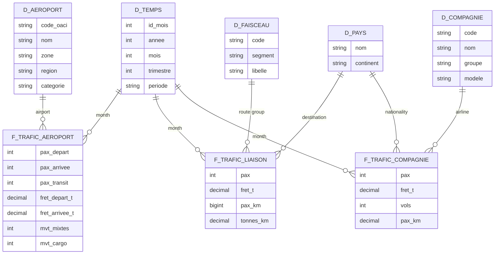

# French Commercial Air Traffic

**BI project — IPSA 3IA, 2025-2026**

> How has French commercial air traffic been redistributed across airports, regions, destinations and airlines since 1990?

---

## The question

Over thirty-five years, French air transport has changed profoundly: liberalisation of European airspace, the rise of low-cost carriers, high-speed rail (TGV) competing on domestic routes, collapse and then recovery after the pandemic.

This project builds a data warehouse and a dashboard to **measure these shifts**: which airports are gaining or losing traffic, which regions are back to their pre-crisis level, where passengers fly to, and which airlines capture the growth.

Existing sites such as [PijassBox](https://pijassbox.fr/donnees/aeroport/LFPG/) present one page per airport. This project focuses instead on **comparison** across airports, regions, route groups and airlines.

## Use cases

| # | Use case | Series | What we want to show |
|---|---|---|---|
| 1 | **Winners and losers** | APT | Airports ranked by growth over 10 and 30 years; concentration of traffic between Paris and the regions |
| 2 | **Post-pandemic recovery** | APT | Month in which traffic returned to its 2019 level, by airport and by region |
| 3 | **Seasonality** | APT | Compared monthly profiles: Paris hubs, regional airports, tourist airports, overseas territories |
| 4 | **Destinations and rail competition** | LSN | Domestic versus international; decline of Paris-regions routes; destination countries and continents |
| 5 | **Low-cost versus legacy carriers** | CIE | Market share trends since 2010; Air France against easyJet, Ryanair, Transavia, Volotea |

## Data

| Item | Detail |
|---|---|
| Publisher | [French Civil Aviation Authority (DGAC)](https://www.data.gouv.fr/organizations/direction-generale-de-laviation-civile/datasets) |
| Dataset | [Monthly French commercial air traffic](https://www.data.gouv.fr/datasets/trafic-aerien-commercial-mensuel-francais-par-paire-daeroports-par-sens-depuis-1990) |
| Format | One CSV per year and per series, `;` separator, comma decimals, UTF-8 |
| Update frequency | Yearly |
| Licence | Licence Ouverte / Open Licence (Etalab) |

### Series used

| Series | One row = | Period | Main measures | Detail threshold |
|---|---|---|---|---|
| `ASP_APT` | one airport, one month | 1990-2025 | passengers (departures, arrivals, transit), freight, movements | 1,000 passengers per month; below that, grouped as mainland / overseas |
| `ASP_LSN` | one route group or destination country, one month | 1990-2025 | passengers, freight, passenger-kilometres | about 5,000 equivalent passengers; below that, "other" rows |
| `ASP_CIE` | one airline, one month | 2010-2025 | passengers, freight, flights, passenger-kilometres | 10,000 passengers; below that, grouped as French / foreign airlines |

### Series left out

`ASP_PAP` (traffic by airport pair) covers only about 40% of traffic. Because of statistical confidentiality, a route is published only if at least three airlines operate it and none holds more than 85% of the traffic. Routes run by a single airline, including much of the domestic network, are missing, and the list of pairs changes from month to month. It cannot support trend analysis.

Field descriptions are in the PDF notices published with the dataset (`Notice_ASP_serie_APT`, `_LSN`, `_CIE`).

## Data model

A constellation of three star schemas at monthly grain, sharing their common dimensions.



Table and column names are kept in French, as in the database.

### Bus matrix

| Dimension | `f_trafic_aeroport` | `f_trafic_liaison` | `f_trafic_compagnie` |
|---|:---:|:---:|:---:|
| `d_temps` (time) | X | X | X |
| `d_aeroport` (airport) | X | | |
| `d_faisceau` (route group) | | X | |
| `d_pays` (country) | | X (destination) | X (nationality) |
| `d_compagnie` (airline) | | | X |

`d_temps` is conformed across all three fact tables: the recovery of airports, destinations and airlines can be compared over the same period. `d_pays` plays two roles: destination country for routes, home country for airlines.

### Enrichment

The DGAC series contain only codes and volumes. The project adds:

- the **region** of each airport, and its **category** (Paris hub, regional, tourist, overseas);
- the **continent** of each country;
- the **group** of each airline (for example, merging the easyJet UK, Europe and Switzerland entities) and its **business model** (low-cost, legacy, regional, charter);
- the **period** of each month (pre-crisis, pandemic, recovery);
- **opening dates of TGV lines**, to interpret the trend of Paris-regions routes.

## Decision grid

| Decision question | Indicators | Analysis axes | Decision supported |
|---|---|---|---|
| Which airports should be invested in or restructured? | Average annual growth, share of national traffic | Airport, region, period | Prioritising infrastructure investment |
| Which regions remain fragile after the crisis? | Gap to 2019 traffic, month of return to the 2019 level | Region, airport, month | Targeted support for airports lagging in recovery |
| How should operations be sized by season? | Seasonal index, peak / trough ratio | Month, airport category | Staff and capacity planning |
| Is rail replacing air on domestic routes? | Paris-regions traffic, domestic share | Route group, year | Intermodal policy, air / rail trade-offs |
| Which airlines should be attracted? | Market share, growth by airline model | Airline, group, model, year | Commercial strategy of airports and regions |

## Limitations and watch-outs

- **Publication thresholds.** An airport, route or airline can appear or disappear as it crosses the threshold. Of 147 airports seen at least once, only 67 are present in all 36 years: a disappearance does not mean a closure.
- **Domestic double counting.** APT counts each passenger at both the departure and the arrival airport. The APT total (211 M in 2025) is therefore not comparable with the LSN and CIE totals (183 M): the series are never added together.
- **No routes by airport.** Destinations are known only at national level (LSN), not per airport.
- **CIE starts in 2010.** The airline analysis covers 2010-2025.
- **Series breaks.** Airport names, airline entities and "other" groupings change over time: to be checked during cleaning.
- **No punctuality data.** The series contain no delays or cancellations.

## Tech stack

| Purpose | Tool |
|---|---|
| Data warehouse | SQL Server |
| Loading (ETL) | SSIS |
| Analytical model | SSAS |
| Dashboard | Power BI Desktop, connected to the star schema |
| Data exploration | Python (pandas) |

## Repository structure

```
.
├── data/
│   ├── raw/            # Raw DGAC CSV files, unmodified
│   └── ref/            # Enrichment tables (regions, continents, airlines, TGV)
├── sql/                # Warehouse creation: tables, constraints, views
├── ssis/               # Loading packages
├── ssas/               # Analytical model project
├── notebooks/          # Exploration and quality checks
├── dashboard/          # .pbix file
├── docs/               # Presentation, screenshots, DGAC notices
└── README.md
```

Only `docs/` exists so far; the other folders will be created as the project progresses.

## Getting started

1. **Clone the repository**
   ```bash
   git clone https://github.com/DANUTSHELL/PROJET-Dashboard-Trafic-Aerien-Commercial-Francais-par-Aeroport.git
   cd PROJET-Dashboard-Trafic-Aerien-Commercial-Francais-par-Aeroport
   git config core.hooksPath .githooks
   ```

2. **Download the series** `ASP_APT_1990_2025.zip`, `ASP_LSN_1990_2025.zip` and `ASP_CIE_2010_2025.zip` from [data.gouv.fr](https://www.data.gouv.fr/datasets/trafic-aerien-commercial-mensuel-francais-par-paire-daeroports-par-sens-depuis-1990) and unzip them into `data/raw/`.

3. **Create the warehouse** in SQL Server with the scripts in `sql/`, then **load it** with the packages in `ssis/`.

4. **Deploy the model** in `ssas/`, then **open the dashboard** `dashboard/*.pbix` in Power BI Desktop.

## Deliverables

- **Presentation (PowerPoint)**: dataset overview, analysis objectives, bus matrix, decision grid, star schema, cleaning steps, lessons learned.
- **Dashboard**: `.pbix` file.

## Roadmap

- [ ] Get the topic approved by the instructor
- [ ] Document the data dictionary from the DGAC notices
- [ ] Build the enrichment tables (`data/ref/`)
- [ ] Create the warehouse in SQL Server
- [ ] Develop the SSIS packages: loading, cleaning, populating dimensions and facts
- [ ] Build the SSAS model
- [ ] Build the five use cases in Power BI
- [ ] Prepare the presentation

## Authors

- [@DANUTSHELL](https://github.com/DANUTSHELL)
- [@jules-gillet](https://github.com/jules-gillet)
- [@thibault-dlb](https://github.com/thibault-dlb)

## Licence

Code for educational use.
Data published by the DGAC under the **Licence Ouverte / Open Licence (Etalab)**, to be credited as such.

---

Une version française de ce README est disponible dans [README.md](README.md).
