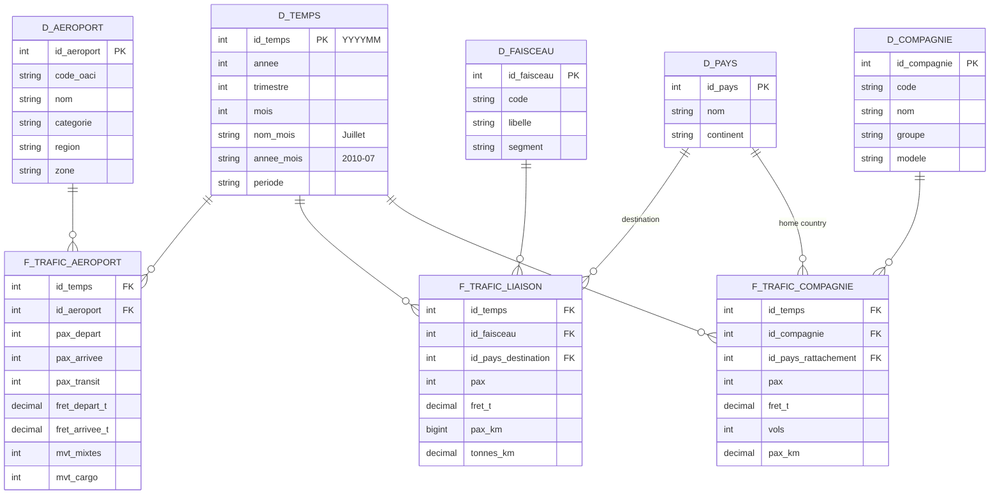

# French Commercial Air Traffic

**BI project — IPSA 3IA, 2025-2026**

> How has French commercial air traffic been redistributed across airports, regions, destinations and airlines since 1990?

---

## The question

Over thirty-five years, French air transport has changed profoundly: liberalisation of European airspace, the rise of low-cost carriers, high-speed rail (TGV) competing on domestic routes, collapse and then recovery after the pandemic.

This project builds a data warehouse, an OLAP cube and a dashboard to **measure these shifts**: which airports are gaining or losing traffic, which regions are back to their pre-crisis level, where passengers fly to, and which airlines capture the growth.

Existing sites such as [PijassBox](https://pijassbox.fr/donnees/aeroport/LFPG/) present one page per airport. This project focuses instead on **comparison** across airports, regions, route groups and airlines.

## Use cases

| # | Use case | Series | What we want to show |
|---|---|---|---|
| 1 | **Winners and losers** | APT | Airports ranked by growth over 10 and 30 years; concentration of traffic between Paris and the regions |
| 2 | **Post-pandemic recovery** | APT | Month in which traffic returned to its 2019 level, by airport and by region |
| 3 | **Seasonality** | APT | Compared monthly profiles: Paris hubs, regional airports, tourist airports, overseas territories |
| 4 | **Destinations and rail competition** | LSN | Domestic versus international; decline of Paris-regions routes; destination countries and continents |
| 5 | **Low-cost versus legacy carriers** | CIE | Market share trends since 2010; Air France against easyJet, Ryanair, Transavia, Volotea |

## Data

| Item | Detail |
|---|---|
| Publisher | [French Civil Aviation Authority (DGAC)](https://www.data.gouv.fr/organizations/direction-generale-de-laviation-civile/datasets) |
| Dataset | [Monthly French commercial air traffic](https://www.data.gouv.fr/datasets/trafic-aerien-commercial-mensuel-francais-par-paire-daeroports-par-sens-depuis-1990) |
| Format | One CSV per year and per series, `;` separator, comma decimals, UTF-8 |
| Update frequency | Yearly |
| Licence | Licence Ouverte / Open Licence (Etalab) |

### Series used

| Series | One row = | Period | Main measures | Detail threshold |
|---|---|---|---|---|
| `ASP_APT` | one airport, one month | 1990-2025 | passengers (departures, arrivals, transit), freight, movements | 1,000 passengers per month; below that, grouped as mainland / overseas |
| `ASP_LSN` | one route group or destination country, one month | 1990-2025 | passengers, freight, passenger-kilometres | about 5,000 equivalent passengers; below that, "other" rows |
| `ASP_CIE` | one airline, one month | 2010-2025 | passengers, freight, flights, passenger-kilometres | 10,000 passengers; below that, grouped as French / foreign airlines |

### Series left out

`ASP_PAP` (traffic by airport pair) covers only about 40% of traffic. Because of statistical confidentiality, a route is published only if at least three airlines operate it and none holds more than 85% of the traffic. Routes run by a single airline, including much of the domestic network, are missing, and the list of pairs changes from month to month. It cannot support trend analysis.

Field descriptions are in the PDF notices published with the dataset (`Notice_ASP_serie_APT`, `_LSN`, `_CIE`).

## Bus matrix

Each DGAC series corresponds to one business process: traffic measured at airports, traffic by route group and destination, traffic by airline.

| Business process | Time | Airport | Route group | Country | Airline |
|---|:---:|:---:|:---:|:---:|:---:|
| Airport traffic (APT) | X | X | | | |
| Route traffic (LSN) | X | | X | X (destination) | |
| Airline traffic (CIE) | X | | | X (home country) | X |

`Time` is the conformed dimension shared by all three processes: it lets us compare, month by month, the recovery of airports, destinations and airlines. `Country` is conformed too, with two roles: destination country for routes, home country for airlines.

The series cannot be linked at a finer level: the DGAC publishes neither destinations by airport nor airports by airline.

## Data model

One star per process in the bus matrix: three fact tables at monthly grain sharing the conformed dimensions. As taught in the course, dimensions use a meaningless numeric surrogate key (`id_*`); DGAC codes (ICAO code, airline code) are kept as attributes. Table and column names are in French, as in the database.



### Hierarchies (drill-down in the cube)

| Dimension | Hierarchy |
|---|---|
| `d_temps` (time) | month → quarter → year |
| `d_aeroport` (airport) | airport → region → zone (mainland / overseas) |
| `d_faisceau` (route group) | route group → segment (domestic / international) |
| `d_pays` (country) | country → continent |
| `d_compagnie` (airline) | airline → group → model (low-cost, legacy, regional, charter) |

### Modelling choices

- **Additive measures**: passengers, freight, movements, flights and passenger-kilometres add up across all dimensions. Ratios (market share, gap to 2019, growth) are not stored: they are computed at reporting time.
- **Pseudo-members**: the DGAC's grouped rows (`ZZMT` and `ZZOM` for small airports, "AUTRES CIE" for small airlines, `*_AUTRE` zones for small countries) become "Other" members of their dimension, so that totals stay correct.
- **Slowly changing dimensions**: airport and airline names change over time. We keep the latest value (type 1): only the displayed name changes, the analysis does not depend on it.
- **Route table**: for domestic route groups, the destination country is France.

### Enrichment

The DGAC series contain only codes and volumes. The project adds:

- the **region** of each airport, and its **category** (Paris hub, regional, tourist, overseas);
- the **continent** of each country;
- the **group** of each airline (for example, merging the easyJet UK, Europe and Switzerland entities) and its **business model**;
- the **period** of each month (pre-crisis, pandemic, recovery);
- **opening dates of TGV lines**, to interpret the trend of Paris-regions routes.

## Prioritisation grid

Each analysis theme is placed according to its **business value** and its **ease of implementation**; high-value, easy themes come first.

| | Low ease | High ease |
|---|---|---|
| **High value** | Low-cost versus legacy carriers | Winners and losers; post-pandemic recovery; destinations and rail competition |
| **Low value** | | Seasonality |

| Theme | Business value | Ease | Rationale | Batch |
|---|---|---|---|---|
| Winners and losers | High | High | Single series (APT), clean since 1990 | 1 |
| Post-pandemic recovery | High | High | APT plus an airport → region table to build | 1 |
| Destinations and rail competition | High | High | LSN is complete; add continents and TGV dates | 1 |
| Seasonality | Low | High | Reuses the APT star, no new data | 2 |
| Low-cost versus legacy carriers | High | Low | Merge entities and classify about 140 airlines by hand; data only since 2010 | 2 |

## Decision questions

| Question | Indicators | Analysis axes | Decision supported |
|---|---|---|---|
| Which airports should be invested in or restructured? | Average annual growth, share of national traffic | Airport, region, period | Prioritising infrastructure investment |
| Which regions remain fragile after the crisis? | Gap to 2019 traffic, month of return to the 2019 level | Region, airport, month | Targeted support for airports lagging in recovery |
| How should operations be sized by season? | Seasonal index, peak / trough ratio | Month, airport category | Staff and capacity planning |
| Is rail replacing air on domestic routes? | Paris-regions traffic, domestic share | Route group, year | Intermodal policy, air / rail trade-offs |
| Which airlines should be attracted? | Market share, growth by airline model | Airline, group, model, year | Commercial strategy of airports and regions |

## Limitations and watch-outs

- **Publication thresholds.** An airport, route or airline can appear or disappear as it crosses the threshold. Of 147 airports seen at least once, only 67 are present in all 36 years: a disappearance does not mean a closure.
- **Domestic double counting.** APT counts each passenger at both the departure and the arrival airport. The APT total (211 M in 2025) is therefore not comparable with the LSN and CIE totals (183 M): the series are never added together.
- **No routes by airport.** Destinations are known only at national level (LSN), not per airport.
- **CIE starts in 2010.** The airline analysis covers 2010-2025.
- **Series breaks.** Airport names, airline entities and "other" groupings change over time: to be checked during cleaning.
- **No punctuality data.** The series contain no delays or cancellations.

## Architecture and tech stack


| Step | Tool | Content |
|---|---|---|
| Database | SQL Server (SSMS) | Creating the database, raw `stg_*` tables, dimensions and facts |
| Loading (ETL) | SSIS | Loading raw CSV files, cleaning, enrichment, populating dimensions then facts; packages deployed in SSMS |
| Analytical model | SSAS | Multidimensional project: OLAP cube built on the star schema, with its hierarchies |
| Reporting | Power BI Desktop | Connection to the SSAS cube, visuals per use case; the whole chain runs locally |
| Exploration | Python (pandas) | Data profiling and quality checks, outside the production pipeline |

### Quality checks

To validate loading, totals are compared from the general to the detailed level across the raw CSV files, the raw tables, the warehouse and the cube: row counts, total passengers per year, then per month. Orders of magnitude are cross-checked against the [DGAC statistical bulletins](https://www.ecologie.gouv.fr/politiques-publiques/statistiques-du-trafic-aerien). Check queries are kept in `sql/`.

## Repository structure

```
.
├── data/
│   ├── raw/            # Raw DGAC CSV files, unmodified
│   └── ref/            # Enrichment tables (regions, continents, airlines, TGV)
├── sql/                # Database and table creation, check queries
├── ssis/               # Loading project and packages
├── ssas/               # Multidimensional project (OLAP cube)
├── notebooks/          # Data exploration and profiling
├── dashboard/          # .pbix file
├── docs/               # Presentation, screenshots, DGAC notices
└── README.md
```

Only `docs/` exists so far; the other folders will be created as the project progresses.

## Getting started

1. **Clone the repository**
   ```bash
   git clone https://github.com/DANUTSHELL/PROJET-Dashboard-Trafic-Aerien-Commercial-Francais-par-Aeroport.git
   cd PROJET-Dashboard-Trafic-Aerien-Commercial-Francais-par-Aeroport
   git config core.hooksPath .githooks
   ```

2. **Download the series** `ASP_APT_1990_2025.zip`, `ASP_LSN_1990_2025.zip` and `ASP_CIE_2010_2025.zip` from [data.gouv.fr](https://www.data.gouv.fr/datasets/trafic-aerien-commercial-mensuel-francais-par-paire-daeroports-par-sens-depuis-1990) and unzip them into `data/raw/`.

3. **Create the database** in SQL Server with the scripts in `sql/`, then **deploy and run** the packages in `ssis/`.

4. **Deploy the cube** from the `ssas/` project, then **open the dashboard** `dashboard/*.pbix` in Power BI Desktop, connected to the cube.

## Deliverables

- **Presentation (PowerPoint)**:
  - overview: context, question, objectives, solution, team members and division of work;
  - dataset presentation;
  - implementation method: bus matrix, prioritisation grid, SSIS integration, star schema and OLAP cube;
  - cleaning steps;
  - Power BI visuals;
  - lessons learned: achievements, difficulties, possible extensions.
- **Dashboard**: `.pbix` file, connected to the SSAS cube, shown in a local demo.

## Roadmap

Each step is detailed (tasks, acceptance criteria, mapping to the grading grid, control values) in [docs/feuille-de-route.md](docs/feuille-de-route.md), in French.

- [ ] Get the topic approved by the instructor
- [ ] Document the data dictionary from the DGAC notices
- [ ] Build the enrichment tables (`data/ref/`)
- [ ] Create the SQL Server database and raw tables
- [ ] Develop the SSIS packages (raw load, cleaning, dimensions, facts) and deploy them in SSMS
- [ ] Create the dimension and fact tables, and check them against the bus matrix
- [ ] Create the SSAS project, then build and deploy the OLAP cube
- [ ] Check that the cube schema matches the star schema
- [ ] Connect Power BI to the cube and build the visuals, batch 1 then batch 2
- [ ] Prepare the local demo of the report
- [ ] Prepare the presentation

## Authors

- [@DANUTSHELL](https://github.com/DANUTSHELL)
- [@jules-gillet](https://github.com/jules-gillet)
- [@thibault-dlb](https://github.com/thibault-dlb)

## Licence

Code for educational use.
Data published by the DGAC under the **Licence Ouverte / Open Licence (Etalab)**, to be credited as such.

---

Une version française de ce README est disponible dans [README.md](README.md).
