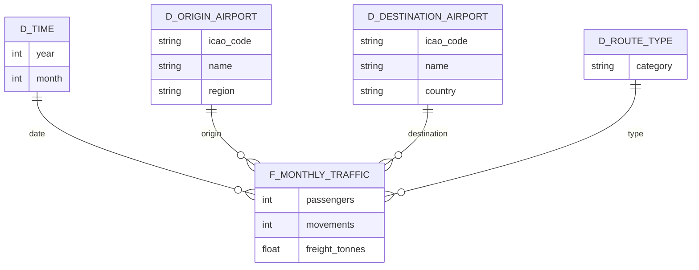

# French Commercial Air Traffic by Airport

**Project 2 — Data visualisation dashboard**

> How has French commercial air traffic evolved by airport and by route since the 1990s, and which airports are growing or declining?

---

## The question

French air traffic has been through three decades of upheaval: liberalisation of European skies, the rise of low-cost carriers, high-speed rail competition on domestic routes, and the collapse and recovery around the health crisis.

This project builds a dashboard that **measures those dynamics airport by airport and route by route**, and identifies which platforms are growing and which are declining.

## Use cases

| # | Use case | What it shows |
|---|---|---|
| 1 | **Monthly traffic per airport** | Each platform's long-run trajectory since 1990 |
| 2 | **Domestic vs. international** | Weight and evolution of the main routes in each category |
| 3 | **Post-pandemic recovery by region** | Speed of return to 2019 levels, and gaps between territories |
| 4 | **Seasonality comparison** | Monthly profiles of regional airports against the Paris hubs |

## Data

| Item | Detail |
|---|---|
| Publisher | [Direction générale de l'aviation civile (DGAC)](https://www.data.gouv.fr/organizations/direction-generale-de-laviation-civile/datasets) |
| Primary dataset | [Monthly French commercial air traffic by airport pair, by direction, since 1990](https://www.data.gouv.fr/datasets/trafic-aerien-commercial-mensuel-francais-par-paire-daeroports-par-sens-depuis-1990) |
| Grain | Monthly, by airport pair and by direction |
| Coverage | From 1990 onwards |
| Format | CSV |
| Refresh | Yearly |
| Licence | Licence Ouverte / Open Licence (Etalab) |

**Cross-check source:** the [DGAC annual statistical bulletins](https://www.ecologie.gouv.fr/politiques-publiques/statistiques-du-trafic-aerien) are used to validate orders of magnitude and fill gaps left by the CSV.

**Companion series:**
- `ASP_LSN_AAAA` — traffic by route bundle and connection, by country
- `ASP_CIE_AAAA` — traffic by airline (since 2010, 10 UDT threshold)

## Data model

Star schema, with a fact table at the grain of **month × airport pair × direction**.



| Table | Role | Key attributes |
|---|---|---|
| `f_monthly_traffic` | Fact | passengers, movements, freight |
| `d_time` | Dimension | year, month |
| `d_origin_airport` | Dimension | code, name, region |
| `d_destination_airport` | Dimension | code, name, country |
| `d_route_type` | Dimension | domestic / international |

> `d_origin_airport` and `d_destination_airport` are two **roles of the same airport dimension**: implement as a role-playing dimension (Power BI) or as a double join onto a single table.

## Limitations and watch-outs

- **Check the grain first.** Some DGAC datasets are published **already aggregated**. Before building the model, confirm the CSV really goes down to month × airport pair — otherwise use cases 1 and 4 (seasonality) collapse.
- **Publication threshold.** Monthly figures are only broken down for aerodromes reaching at least **one traffic unit (UDT)** — one thousand passengers, or one hundred kilograms of freight or mail. Small aerodromes are therefore missing or aggregated: state this in the analysis, or risk reading a publication threshold as a "decline".
- **Series breaks.** Over thirty-five years, airport codes, scopes and classifications change. Verify continuity before any 1990 ↔ today comparison.
- **Directional flows.** The data is per direction: watch for double counting when aggregating to airport level without deduplicating.

## Tech stack

| Purpose | Tool |
|---|---|
| Dashboard | Power BI Desktop |
| Data preparation | Power Query / Python (pandas) |
| Sources | DGAC CSV files versioned under `data/` |

## Repository structure

> **Planned** structure — the repository is still being set up.

```
.
├── data/
│   ├── raw/            # Raw CSV downloads from data.gouv.fr (left untouched)
│   └── clean/          # Cleaned data, ready for the model
├── notebooks/          # Exploration, grain checks, cleaning
├── dashboard/          # .pbix file and exports
├── docs/               # Screenshots, report, presentation deck
└── README.md
```

## Getting started

1. **Clone the repository**
   ```bash
   git clone https://github.com/DANUTSHELL/PROJET-Dashboard-Trafic-Aerien-Commercial-Francais-par-Aeroport.git
   cd PROJET-Dashboard-Trafic-Aerien-Commercial-Francais-par-Aeroport
   ```

2. **Download the dataset** from [data.gouv.fr](https://www.data.gouv.fr/datasets/trafic-aerien-commercial-mensuel-francais-par-paire-daeroports-par-sens-depuis-1990) and place it in `data/raw/`.

3. **Check the grain** before anything else (see watch-outs).

4. **Open the dashboard**: the `.pbix` under `dashboard/` with Power BI Desktop.

> The raw CSVs are large. If the repository approaches GitHub's limits, add `data/raw/` to `.gitignore` and document the download link instead.

## Roadmap

- [ ] Download the dataset and verify the actual grain
- [ ] Document the data dictionary
- [ ] Clean: airport codes, date typing, missing values, series breaks
- [ ] Build the star schema
- [ ] Develop the four use cases
- [ ] Write up the analysis and findings
- [ ] Prepare the presentation deck

## Authors

- [@DANUTSHELL](https://github.com/DANUTSHELL)
- [@jules-gillet](https://github.com/jules-gillet)
- [@thibault-dlb](https://github.com/thibault-dlb)

## Licence

Code for educational use.
Data published by the DGAC under the **Licence Ouverte / Open Licence (Etalab)**, to be credited accordingly.

---

Une version française de ce README est disponible dans [README.md](README.md).
