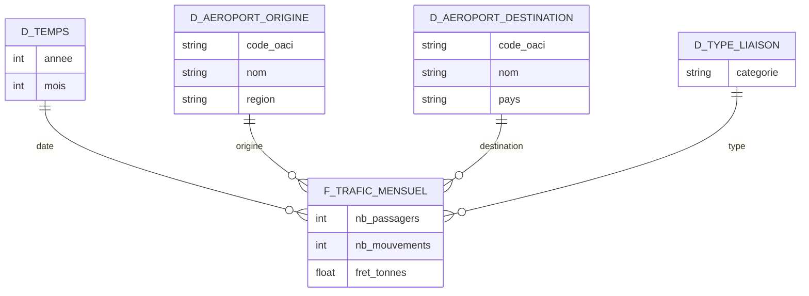

# ✈️ Trafic aérien commercial français par aéroport

**Projet 2 — Tableau de bord de data visualisation**

> Comment évolue le trafic commercial français par aéroport et par liaison depuis les années 1990, et quels aéroports sont en croissance ou en déclin ?

---

## 📋 Problématique

Le trafic aérien français a connu trois décennies de transformations : libéralisation du ciel européen, montée du low-cost, concurrence du TGV sur le domestique, effondrement puis reprise post-crise sanitaire.

Ce projet construit un tableau de bord permettant de **mesurer ces dynamiques aéroport par aéroport et liaison par liaison**, et d'identifier les plateformes en croissance comme celles en déclin.

## 🎯 Cas d'usage

| # | Cas d'usage | Ce qu'on cherche à montrer |
|---|---|---|
| 1 | **Évolution mensuelle du trafic par aéroport** | Trajectoire longue de chaque plateforme depuis 1990 |
| 2 | **Domestique vs. international** | Poids et évolution des principales liaisons de chaque catégorie |
| 3 | **Reprise post-crise sanitaire par région** | Vitesse de retour au niveau 2019, et écarts entre territoires |
| 4 | **Comparaison saisonnière** | Profils mensuels des aéroports régionaux face aux hubs parisiens |

## 📊 Données

| Élément | Détail |
|---|---|
| Producteur | [Direction générale de l'aviation civile (DGAC)](https://www.data.gouv.fr/organizations/direction-generale-de-laviation-civile/datasets) |
| Jeu principal | [Trafic aérien commercial mensuel français par paire d'aéroports, par sens, depuis 1990](https://www.data.gouv.fr/datasets/trafic-aerien-commercial-mensuel-francais-par-paire-daeroports-par-sens-depuis-1990) |
| Granularité | Mensuelle, par paire d'aéroports et par sens |
| Profondeur | Depuis 1990 |
| Format | CSV |
| Mise à jour | Annuelle |
| Licence | Licence Ouverte / Open Licence (Etalab) |

**Source de recoupement :** les [bulletins statistiques annuels de la DGAC](https://www.ecologie.gouv.fr/politiques-publiques/statistiques-du-trafic-aerien) servent à valider les ordres de grandeur et à combler les zones d'ombre du CSV.

**Séries complémentaires disponibles :**
- `ASP_LSN_AAAA` — trafic par faisceau et liaison, par pays
- `ASP_CIE_AAAA` — trafic par compagnie aérienne (depuis 2010, seuil de 10 UDT)

## 🧱 Modèle de données

Modèle en étoile, une table de faits au grain **mois × paire d'aéroports × sens**.



| Table | Rôle | Attributs clés |
|---|---|---|
| `f_trafic_mensuel` | Faits | passagers, mouvements, fret |
| `d_temps` | Dimension | année, mois |
| `d_aeroport_origine` | Dimension | code, nom, région |
| `d_aeroport_destination` | Dimension | code, nom, pays |
| `d_type_liaison` | Dimension | domestique / international |

> `d_aeroport_origine` et `d_aeroport_destination` sont deux **rôles de la même dimension aéroport** : à implémenter en role-playing dimension (Power BI) ou en double jointure sur une table unique.

## ⚠️ Limites et points de vigilance

- **Granularité à vérifier en priorité.** Certains jeux DGAC sont publiés **déjà agrégés**. Avant de bâtir le modèle, confirmer que le CSV descend bien au mois × paire d'aéroports — sinon les cas d'usage 1 et 4 (saisonnalité) tombent.
- **Seuil de publication.** Les résultats mensuels ne sont détaillés que pour les aérodromes atteignant au moins **une unité de trafic (UDT)** — mille passagers, ou cent kilogrammes de fret ou de poste. Les petits aérodromes sont donc absents ou agrégés : à signaler dans l'analyse, sous peine de conclure à tort à un « déclin ».
- **Ruptures de série.** Sur trente-cinq ans, les codes aéroports, les périmètres et les nomenclatures changent. Vérifier la continuité avant toute comparaison 1990 ↔ aujourd'hui.
- **Sens des flux.** Les données sont par sens : attention au double comptage si l'on agrège au niveau aéroport sans dédoublonner.

## 🛠️ Stack technique

| Usage | Outil |
|---|---|
| Tableau de bord | Power BI Desktop |
| Préparation des données | Power Query / Python (pandas) |
| Sources | CSV DGAC versionnés dans `data/` |

## 🗂️ Structure du dépôt

> ⚠️ Structure **prévue** — le dépôt est en cours d'initialisation.

```
.
├── data/
│   ├── raw/            # CSV bruts téléchargés depuis data.gouv.fr (non modifiés)
│   └── clean/          # Données nettoyées, prêtes pour le modèle
├── notebooks/          # Exploration, contrôle de granularité, nettoyage
├── dashboard/          # Fichier .pbix et exports
├── docs/               # Captures, rapport, support de présentation
└── README.md
```

## 🚀 Démarrage

1. **Cloner le dépôt**
   ```bash
   git clone https://github.com/DANUTSHELL/PROJET-Dashboard-Trafic-Aerien-Commercial-Francais-par-Aeroport.git
   cd PROJET-Dashboard-Trafic-Aerien-Commercial-Francais-par-Aeroport
   ```

2. **Télécharger le jeu de données** depuis [data.gouv.fr](https://www.data.gouv.fr/datasets/trafic-aerien-commercial-mensuel-francais-par-paire-daeroports-par-sens-depuis-1990) et le placer dans `data/raw/`.

3. **Contrôler la granularité** avant tout le reste (cf. points de vigilance).

4. **Ouvrir le tableau de bord** : le `.pbix` sous `dashboard/` avec Power BI Desktop.

> 💡 Les CSV bruts sont volumineux. Si le dépôt approche les limites GitHub, ajouter `data/raw/` au `.gitignore` et documenter le lien de téléchargement à la place.

## 🗺️ Feuille de route

- [ ] Télécharger le jeu de données et vérifier la granularité réelle
- [ ] Documenter le dictionnaire des variables
- [ ] Nettoyer : codes aéroports, typage des dates, valeurs manquantes, ruptures de série
- [ ] Construire le modèle en étoile
- [ ] Développer les quatre cas d'usage
- [ ] Rédiger l'analyse et les conclusions
- [ ] Préparer le support de présentation

## 👥 Auteurs

- [@DANUTSHELL](https://github.com/DANUTSHELL)
- [@jules-gillet](https://github.com/jules-gillet)

## 📄 Licence

Code à usage pédagogique.
Données publiées par la DGAC sous **Licence Ouverte / Open Licence (Etalab)**, à citer comme telles.

---

🇬🇧 An English version of this README is available in [README.en.md](README.en.md).
