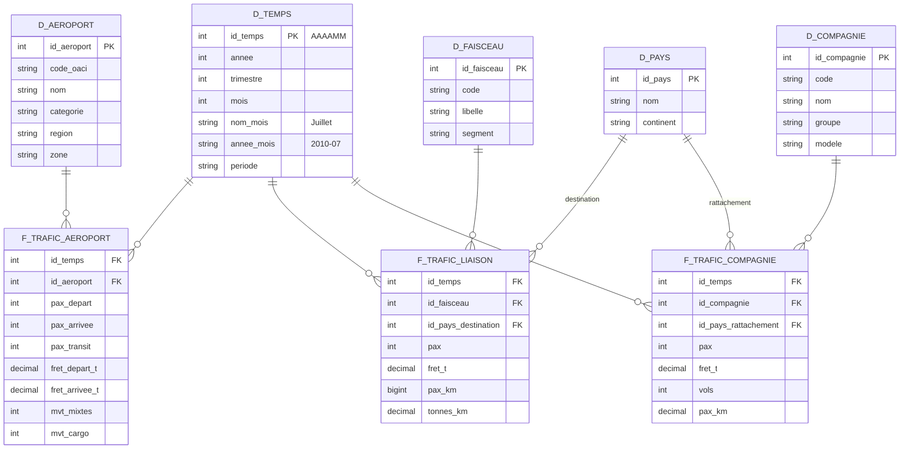

# Trafic aérien commercial français

**Projet BI — IPSA 3IA, 2025-2026**

> Comment le trafic aérien commercial français s'est-il redistribué entre aéroports, territoires, destinations et compagnies depuis 1990 ?

---

## Problématique

En trente-cinq ans, le transport aérien français a profondément changé : libéralisation du ciel européen, montée des compagnies low-cost, concurrence du TGV sur les liaisons intérieures, effondrement puis reprise après la crise sanitaire.

Ce projet construit un entrepôt de données, un cube OLAP et un tableau de bord pour **mesurer ces recompositions** : quels aéroports gagnent ou perdent du trafic, quels territoires ont retrouvé leur niveau d'avant-crise, vers quelles destinations partent les passagers, et quelles compagnies captent la croissance.

Les sites existants, comme [PijassBox](https://pijassbox.fr/donnees/aeroport/LFPG/), présentent une fiche par aéroport. Ce projet se concentre au contraire sur la **comparaison** entre aéroports, régions, faisceaux et compagnies.

## Cas d'usage

| # | Cas d'usage | Série | Ce qu'on cherche à montrer |
|---|---|---|---|
| 1 | **Gagnants et perdants** | APT | Classement des aéroports par croissance sur 10 et 30 ans ; concentration du trafic entre Paris et les régions |
| 2 | **Reprise après la crise sanitaire** | APT | Mois du retour au niveau de 2019, par aéroport et par région |
| 3 | **Saisonnalité** | APT | Profils mensuels comparés : hubs parisiens, aéroports régionaux, aéroports touristiques, outre-mer |
| 4 | **Destinations et concurrence du TGV** | LSN | Domestique contre international ; recul des liaisons Paris-province ; pays et continents de destination |
| 5 | **Low-cost contre compagnies traditionnelles** | CIE | Évolution des parts de marché depuis 2010 ; poids d'Air France face à easyJet, Ryanair, Transavia, Volotea |

## Données

| Élément | Détail |
|---|---|
| Producteur | [Direction générale de l'aviation civile (DGAC)](https://www.data.gouv.fr/organizations/direction-generale-de-laviation-civile/datasets) |
| Jeu de données | [Trafic aérien commercial mensuel français](https://www.data.gouv.fr/datasets/trafic-aerien-commercial-mensuel-francais-par-paire-daeroports-par-sens-depuis-1990) |
| Format | Un CSV par an et par série, séparateur `;`, décimales à la virgule, UTF-8 |
| Mise à jour | Annuelle |
| Licence | Licence Ouverte / Open Licence (Etalab) |

### Séries retenues

| Série | Une ligne = | Période | Mesures principales | Seuil de détail |
|---|---|---|---|---|
| `ASP_APT` | un aéroport, un mois | 1990-2025 | passagers (départs, arrivées, transit), fret, mouvements | 1 000 passagers par mois ; en dessous, regroupement métropole / outre-mer |
| `ASP_LSN` | un faisceau ou un pays de destination, un mois | 1990-2025 | passagers, fret, passagers-kilomètres | environ 5 000 passagers équivalents ; en dessous, lignes « autres » |
| `ASP_CIE` | une compagnie, un mois | 2010-2025 | passagers, fret, vols, passagers-kilomètres | 10 000 passagers ; en dessous, regroupement compagnies françaises / étrangères |

### Série écartée

`ASP_PAP` (trafic par paire d'aéroports) ne couvre qu'environ 40 % du trafic. Par secret statistique, une liaison n'y figure que si elle compte au moins trois compagnies, dont aucune ne dépasse 85 % du trafic. Les liaisons tenues par une seule compagnie, dont une grande partie du domestique, en sont absentes, et la liste des paires change d'un mois à l'autre. Elle ne permet pas d'analyser des tendances.

La description des champs se trouve dans les notices PDF publiées avec le jeu de données (`Notice_ASP_serie_APT`, `_LSN`, `_CIE`).

## Matrice de bus décisionnel

Chaque série DGAC correspond à un processus métier : le trafic mesuré aux aéroports, le trafic par faisceau et destination, le trafic par compagnie.

| Processus métier | Temps | Aéroport | Faisceau | Pays | Compagnie |
|---|:---:|:---:|:---:|:---:|:---:|
| Trafic des aéroports (APT) | X | X | | | |
| Trafic des liaisons (LSN) | X | | X | X (destination) | |
| Trafic des compagnies (CIE) | X | | | X (rattachement) | X |

`Temps` est la dimension conforme partagée par les trois processus : elle permet de comparer, sur un même mois, la reprise des aéroports, celle des destinations et celle des compagnies. `Pays` est aussi conforme, avec deux rôles : pays de destination pour les liaisons, pays de rattachement pour les compagnies.

Les séries ne se relient pas plus finement : la DGAC ne publie ni les destinations par aéroport, ni les aéroports par compagnie.

## Modèle de données

Une étoile par processus de la matrice, soit trois tables de faits au grain mensuel qui partagent les dimensions conformes. Conformément au cours, les dimensions ont une clé de substitution numérique sans signification (`id_*`) ; les codes de la DGAC (code OACI, code compagnie) restent des attributs.



### Hiérarchies (forage dans le cube)

| Dimension | Hiérarchie |
|---|---|
| `d_temps` | mois → trimestre → année |
| `d_aeroport` | aéroport → région → zone (métropole / outre-mer) |
| `d_faisceau` | faisceau → segment (intérieur / international) |
| `d_pays` | pays → continent |
| `d_compagnie` | compagnie → groupe → modèle (low-cost, traditionnelle, régionale, charter) |

### Choix de modélisation

- **Mesures additives** : passagers, fret, mouvements, vols et passagers-kilomètres s'additionnent sur toutes les dimensions. Les ratios (part de marché, écart à 2019, croissance) ne sont pas stockés : ils sont calculés à la restitution.
- **Pseudo-membres** : les lignes regroupées de la DGAC (`ZZMT` et `ZZOM` pour les petits aéroports, « AUTRES CIE » pour les petites compagnies, zones `*_AUTRE` pour les petits pays) deviennent des membres « Autres » de leur dimension, pour que les totaux restent justes.
- **Dimensions à évolution lente** : les noms d'aéroports et de compagnies changent au fil du temps. On conserve la dernière valeur (type 1) : seul le nom affiché change, l'analyse n'en dépend pas.
- **Table des liaisons** : pour les faisceaux intérieurs, le pays de destination est la France.

### Enrichissements

Les séries DGAC ne contiennent que des codes et des volumes. Le projet ajoute :

- **Région** de chaque aéroport, et sa **catégorie** (hub parisien, régional, touristique, outre-mer) ;
- **Continent** de chaque pays ;
- **Groupe** de chaque compagnie (regroupement des entités easyJet UK, Europe et Switzerland, par exemple) et son **modèle** ;
- **Période** de chaque mois (avant-crise, crise sanitaire, reprise) ;
- **Mises en service des lignes TGV**, pour lire l'évolution des liaisons Paris-province.

## Grille de priorisation

Chaque thème d'analyse est placé selon sa **valeur métier** et sa **facilité de mise en œuvre** ; on commence par les thèmes à forte valeur et faciles à réaliser.

| | Facilité faible | Facilité importante |
|---|---|---|
| **Valeur importante** | Low-cost contre compagnies traditionnelles | Gagnants et perdants ; reprise après la crise sanitaire ; destinations et concurrence du TGV |
| **Valeur faible** | | Saisonnalité |

| Thème | Valeur métier | Facilité | Justification | Lot |
|---|---|---|---|---|
| Gagnants et perdants | Importante | Importante | Une seule série (APT), propre depuis 1990 | 1 |
| Reprise après la crise sanitaire | Importante | Importante | APT et une table aéroport → région à construire | 1 |
| Destinations et concurrence du TGV | Importante | Importante | LSN est complète ; ajouter les continents et les dates TGV | 1 |
| Saisonnalité | Faible | Importante | Réutilise l'étoile APT, sans nouvelle donnée | 2 |
| Low-cost contre compagnies traditionnelles | Importante | Faible | Regrouper les entités et classer environ 140 compagnies à la main ; données depuis 2010 seulement | 2 |

## Questions décisionnelles

| Question | Indicateurs | Axes d'analyse | Décision éclairée |
|---|---|---|---|
| Quels aéroports investir ou restructurer ? | Croissance annuelle moyenne, part du trafic national | Aéroport, région, période | Priorisation des investissements d'infrastructure |
| Quels territoires restent fragiles après la crise ? | Écart au trafic de 2019, mois de retour au niveau de 2019 | Région, aéroport, mois | Soutien ciblé aux plateformes en retard de reprise |
| Comment dimensionner l'exploitation selon la saison ? | Indice saisonnier, ratio pic / creux | Mois, catégorie d'aéroport | Planification des effectifs et des capacités |
| Le ferroviaire remplace-t-il l'avion sur le domestique ? | Trafic Paris-province, part du domestique | Faisceau, année | Politique d'intermodalité, arbitrage avion / train |
| Quelles compagnies attirer ? | Part de marché, croissance par modèle de compagnie | Compagnie, groupe, modèle, année | Stratégie commerciale des aéroports et des régions |

## Limites et points de vigilance

- **Seuils de publication.** Un aéroport, une liaison ou une compagnie peut apparaître ou disparaître selon qu'il passe au-dessus ou au-dessous du seuil. Sur 147 aéroports présents au moins une fois, 67 seulement le sont sur les 36 ans : une disparition ne signifie pas une fermeture.
- **Double comptage du domestique.** APT compte chaque passager à l'aéroport de départ et à celui d'arrivée. Le total APT (211 M en 2025) n'est donc pas comparable aux totaux LSN et CIE (183 M) : les séries ne s'additionnent jamais entre elles.
- **Aucune liaison par aéroport.** Les destinations ne sont connues qu'au niveau national (LSN), pas par aéroport.
- **CIE ne commence qu'en 2010.** L'analyse des compagnies porte sur 2010-2025.
- **Ruptures de série.** Noms d'aéroports, entités de compagnies et zones « autres » évoluent dans le temps : à contrôler pendant le nettoyage.
- **Pas de ponctualité.** Les séries ne contiennent ni retards ni annulations.

## Architecture et stack technique


| Étape | Outil | Contenu |
|---|---|---|
| Base de données | SQL Server (SSMS) | Création de la base, des tables brutes `stg_*`, des dimensions et des faits |
| Alimentation (ETL) | SSIS | Chargement des CSV bruts, nettoyage, enrichissement, alimentation des dimensions puis des faits ; packages déployés dans SSMS |
| Modèle analytique | SSAS | Projet multidimensionnel : cube OLAP construit sur le modèle en étoile, avec ses hiérarchies |
| Restitution | Power BI Desktop | Connexion au cube SSAS, visuels par cas d'usage ; toute la chaîne tourne en local |
| Exploration | Python (pandas) | Profilage des données et contrôles de qualité, hors chaîne de production |

### Contrôles de qualité

Pour valider le chargement, on compare les totaux, du général au particulier, entre les CSV bruts, les tables brutes, l'entrepôt et le cube : nombre de lignes, total des passagers par année, puis par mois. Les ordres de grandeur sont recoupés avec les [bulletins statistiques de la DGAC](https://www.ecologie.gouv.fr/politiques-publiques/statistiques-du-trafic-aerien). Les requêtes de contrôle sont conservées dans `sql/`.

## Structure du dépôt

```
.
├── data/
│   ├── raw/            # CSV DGAC bruts, non modifiés
│   └── ref/            # Tables d'enrichissement (régions, continents, compagnies, TGV)
├── sql/                # Création de la base, des tables et requêtes de contrôle
├── ssis/               # Projet et packages d'alimentation
├── ssas/               # Projet multidimensionnel (cube OLAP)
├── notebooks/          # Exploration et profilage des données
├── dashboard/          # Fichier .pbix
├── docs/               # Support de soutenance, captures, notices DGAC
└── README.md
```

Seul `docs/` existe pour l'instant ; les autres dossiers seront créés au fil du projet.

## Démarrage

1. **Cloner le dépôt**
   ```bash
   git clone https://github.com/DANUTSHELL/PROJET-Dashboard-Trafic-Aerien-Commercial-Francais-par-Aeroport.git
   cd PROJET-Dashboard-Trafic-Aerien-Commercial-Francais-par-Aeroport
   git config core.hooksPath .githooks
   ```

2. **Télécharger les séries** `ASP_APT_1990_2025.zip`, `ASP_LSN_1990_2025.zip` et `ASP_CIE_2010_2025.zip` depuis [data.gouv.fr](https://www.data.gouv.fr/datasets/trafic-aerien-commercial-mensuel-francais-par-paire-daeroports-par-sens-depuis-1990) et les décompresser dans `data/raw/`.

3. **Créer la base** dans SQL Server avec les scripts de `sql/`, puis **déployer et exécuter** les packages de `ssis/`.

4. **Déployer le cube** du projet `ssas/`, puis **ouvrir le tableau de bord** `dashboard/*.pbix` dans Power BI Desktop, connecté au cube.

## Livrables

- **Support de soutenance (PowerPoint)** :
  - présentation générale : contexte, problématique, objectifs, solution, membres du groupe et répartition du travail ;
  - présentation du jeu de données ;
  - méthode de mise en œuvre : matrice de bus décisionnel, grille de priorisation, intégration SSIS, modèle en étoile et cube OLAP ;
  - étapes de nettoyage ;
  - visuels Power BI ;
  - retour d'expérience : réalisations, difficultés, extensions possibles.
- **Tableau de bord** : fichier `.pbix`, connecté au cube SSAS, présenté en démonstration locale.

## Feuille de route

Le détail de chaque étape (tâches, critères de validation, correspondance avec la grille de notation, valeurs de contrôle) est dans [docs/feuille-de-route.md](docs/feuille-de-route.md).

- [ ] Faire valider la thématique par l'enseignant
- [ ] Documenter le dictionnaire des variables à partir des notices DGAC
- [ ] Construire les tables d'enrichissement (`data/ref/`)
- [ ] Créer la base SQL Server et les tables brutes
- [ ] Développer les packages SSIS (chargement brut, nettoyage, dimensions, faits) et les déployer dans SSMS
- [ ] Créer les tables de dimensions et de faits, et vérifier leur cohérence avec la matrice de bus
- [ ] Créer le projet SSAS, puis construire et déployer le cube OLAP
- [ ] Vérifier que le schéma du cube correspond au modèle en étoile
- [ ] Connecter Power BI au cube et développer les visuels, lot 1 puis lot 2
- [ ] Préparer la démonstration locale du rapport
- [ ] Préparer le support de soutenance

## Auteurs

- [@DANUTSHELL](https://github.com/DANUTSHELL)
- [@jules-gillet](https://github.com/jules-gillet)
- [@thibault-dlb](https://github.com/thibault-dlb)

## Licence

Code à usage pédagogique.
Données publiées par la DGAC sous **Licence Ouverte / Open Licence (Etalab)**, à citer comme telles.

---

An English version of this README is available in [README.en.md](README.en.md).
