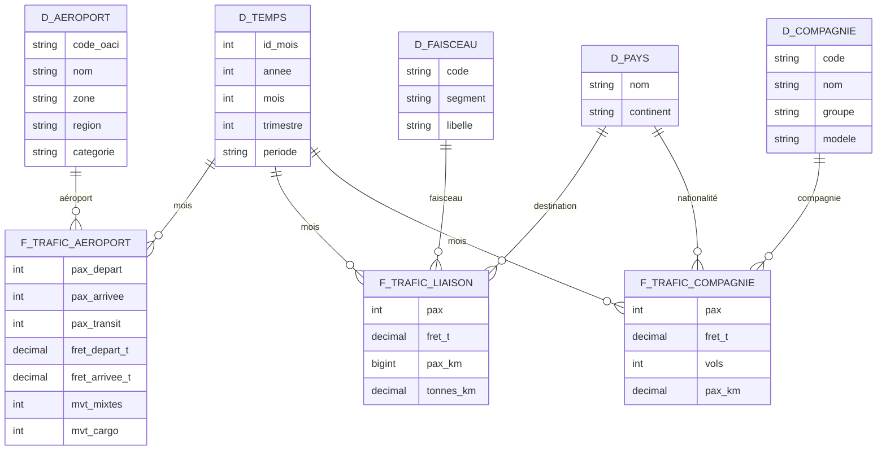

# Trafic aérien commercial français

**Projet BI — IPSA 3IA, 2025-2026**

> Comment le trafic aérien commercial français s'est-il redistribué entre aéroports, territoires, destinations et compagnies depuis 1990 ?

---

## Problématique

En trente-cinq ans, le transport aérien français a profondément changé : libéralisation du ciel européen, montée des compagnies low-cost, concurrence du TGV sur les liaisons intérieures, effondrement puis reprise après la crise sanitaire.

Ce projet construit un entrepôt de données et un tableau de bord pour **mesurer ces recompositions** : quels aéroports gagnent ou perdent du trafic, quels territoires ont retrouvé leur niveau d'avant-crise, vers quelles destinations partent les passagers, et quelles compagnies captent la croissance.

Les sites existants, comme [PijassBox](https://pijassbox.fr/donnees/aeroport/LFPG/), présentent une fiche par aéroport. Ce projet se concentre au contraire sur la **comparaison** entre aéroports, régions, faisceaux et compagnies.

## Cas d'usage

| # | Cas d'usage | Série | Ce qu'on cherche à montrer |
|---|---|---|---|
| 1 | **Gagnants et perdants** | APT | Classement des aéroports par croissance sur 10 et 30 ans ; concentration du trafic entre Paris et les régions |
| 2 | **Reprise après la crise sanitaire** | APT | Mois du retour au niveau de 2019, par aéroport et par région |
| 3 | **Saisonnalité** | APT | Profils mensuels comparés : hubs parisiens, aéroports régionaux, aéroports touristiques, outre-mer |
| 4 | **Destinations et concurrence du TGV** | LSN | Domestique contre international ; recul des liaisons Paris-province ; pays et continents de destination |
| 5 | **Low-cost contre compagnies traditionnelles** | CIE | Évolution des parts de marché depuis 2010 ; poids d'Air France face à easyJet, Ryanair, Transavia, Volotea |

## Données

| Élément | Détail |
|---|---|
| Producteur | [Direction générale de l'aviation civile (DGAC)](https://www.data.gouv.fr/organizations/direction-generale-de-laviation-civile/datasets) |
| Jeu de données | [Trafic aérien commercial mensuel français](https://www.data.gouv.fr/datasets/trafic-aerien-commercial-mensuel-francais-par-paire-daeroports-par-sens-depuis-1990) |
| Format | Un CSV par an et par série, séparateur `;`, décimales à la virgule, UTF-8 |
| Mise à jour | Annuelle |
| Licence | Licence Ouverte / Open Licence (Etalab) |

### Séries retenues

| Série | Une ligne = | Période | Mesures principales | Seuil de détail |
|---|---|---|---|---|
| `ASP_APT` | un aéroport, un mois | 1990-2025 | passagers (départs, arrivées, transit), fret, mouvements | 1 000 passagers par mois ; en dessous, regroupement métropole / outre-mer |
| `ASP_LSN` | un faisceau ou un pays de destination, un mois | 1990-2025 | passagers, fret, passagers-kilomètres | environ 5 000 passagers équivalents ; en dessous, lignes « autres » |
| `ASP_CIE` | une compagnie, un mois | 2010-2025 | passagers, fret, vols, passagers-kilomètres | 10 000 passagers ; en dessous, regroupement compagnies françaises / étrangères |

### Série écartée

`ASP_PAP` (trafic par paire d'aéroports) ne couvre qu'environ 40 % du trafic. Par secret statistique, une liaison n'y figure que si elle compte au moins trois compagnies, dont aucune ne dépasse 85 % du trafic. Les liaisons tenues par une seule compagnie, dont une grande partie du domestique, en sont absentes, et la liste des paires change d'un mois à l'autre. Elle ne permet pas d'analyser des tendances.

La description des champs se trouve dans les notices PDF publiées avec le jeu de données (`Notice_ASP_serie_APT`, `_LSN`, `_CIE`).

## Modèle de données

Constellation de trois schémas en étoile, au grain mensuel, qui partagent les dimensions communes.



### Matrice de bus

| Dimension | `f_trafic_aeroport` | `f_trafic_liaison` | `f_trafic_compagnie` |
|---|:---:|:---:|:---:|
| `d_temps` | X | X | X |
| `d_aeroport` | X | | |
| `d_faisceau` | | X | |
| `d_pays` | | X (destination) | X (nationalité) |
| `d_compagnie` | | | X |

`d_temps` est conforme aux trois tables de faits : on peut comparer sur une même période la reprise des aéroports, celle des destinations et celle des compagnies. `d_pays` joue deux rôles : pays de destination pour les liaisons, pays de rattachement pour les compagnies.

### Enrichissements

Les séries DGAC ne contiennent que des codes et des volumes. Le projet ajoute :

- **Région** de chaque aéroport, et sa **catégorie** (hub parisien, régional, touristique, outre-mer) ;
- **Continent** de chaque pays ;
- **Groupe** de chaque compagnie (regroupement des entités easyJet UK, Europe et Switzerland, par exemple) et son **modèle** (low-cost, traditionnelle, régionale, charter) ;
- **Période** de chaque mois (avant-crise, crise sanitaire, reprise) ;
- **Mises en service des lignes TGV**, pour lire l'évolution des liaisons Paris-province.

## Grille de décision

| Question décisionnelle | Indicateurs | Axes d'analyse | Décision éclairée |
|---|---|---|---|
| Quels aéroports investir ou restructurer ? | Croissance annuelle moyenne, part du trafic national | Aéroport, région, période | Priorisation des investissements d'infrastructure |
| Quels territoires restent fragiles après la crise ? | Écart au trafic de 2019, mois de retour au niveau de 2019 | Région, aéroport, mois | Soutien ciblé aux plateformes en retard de reprise |
| Comment dimensionner l'exploitation selon la saison ? | Indice saisonnier, ratio pic / creux | Mois, catégorie d'aéroport | Planification des effectifs et des capacités |
| Le ferroviaire remplace-t-il l'avion sur le domestique ? | Trafic Paris-province, part du domestique | Faisceau, année | Politique d'intermodalité, arbitrage avion / train |
| Quelles compagnies attirer ? | Part de marché, croissance par modèle de compagnie | Compagnie, groupe, modèle, année | Stratégie commerciale des aéroports et des régions |

## Limites et points de vigilance

- **Seuils de publication.** Un aéroport, une liaison ou une compagnie peut apparaître ou disparaître selon qu'il passe au-dessus ou au-dessous du seuil. Sur 147 aéroports présents au moins une fois, 67 seulement le sont sur les 36 ans : une disparition ne signifie pas une fermeture.
- **Double comptage du domestique.** APT compte chaque passager à l'aéroport de départ et à celui d'arrivée. Le total APT (211 M en 2025) n'est donc pas comparable aux totaux LSN et CIE (183 M) : les séries ne s'additionnent jamais entre elles.
- **Aucune liaison par aéroport.** Les destinations ne sont connues qu'au niveau national (LSN), pas par aéroport.
- **CIE ne commence qu'en 2010.** L'analyse des compagnies porte sur 2010-2025.
- **Ruptures de série.** Noms d'aéroports, entités de compagnies et zones « autres » évoluent dans le temps : à contrôler pendant le nettoyage.
- **Pas de ponctualité.** Les séries ne contiennent ni retards ni annulations.

## Stack technique

| Usage | Outil |
|---|---|
| Entrepôt de données | SQL Server |
| Alimentation (ETL) | SSIS |
| Modèle analytique | SSAS |
| Tableau de bord | Power BI Desktop, connecté au modèle en étoile |
| Exploration des données | Python (pandas) |

## Structure du dépôt

```
.
├── data/
│   ├── raw/            # CSV DGAC bruts, non modifiés
│   └── ref/            # Tables d'enrichissement (régions, continents, compagnies, TGV)
├── sql/                # Création de l'entrepôt : tables, contraintes, vues
├── ssis/               # Packages d'alimentation
├── ssas/               # Projet de modèle analytique
├── notebooks/          # Exploration et contrôles de qualité
├── dashboard/          # Fichier .pbix
├── docs/               # Support de soutenance, captures, notices DGAC
└── README.md
```

Seul `docs/` existe pour l'instant ; les autres dossiers seront créés au fil du projet.

## Démarrage

1. **Cloner le dépôt**
   ```bash
   git clone https://github.com/DANUTSHELL/PROJET-Dashboard-Trafic-Aerien-Commercial-Francais-par-Aeroport.git
   cd PROJET-Dashboard-Trafic-Aerien-Commercial-Francais-par-Aeroport
   git config core.hooksPath .githooks
   ```

2. **Télécharger les séries** `ASP_APT_1990_2025.zip`, `ASP_LSN_1990_2025.zip` et `ASP_CIE_2010_2025.zip` depuis [data.gouv.fr](https://www.data.gouv.fr/datasets/trafic-aerien-commercial-mensuel-francais-par-paire-daeroports-par-sens-depuis-1990) et les décompresser dans `data/raw/`.

3. **Créer l'entrepôt** dans SQL Server avec les scripts de `sql/`, puis **l'alimenter** avec les packages de `ssis/`.

4. **Déployer le modèle** de `ssas/`, puis **ouvrir le tableau de bord** `dashboard/*.pbix` dans Power BI Desktop.

## Livrables

- **Support de soutenance (PowerPoint)** : présentation du jeu de données, objectifs des analyses, matrice de bus, grille de décision, modèle en étoile, étapes de nettoyage, retour d'expérience.
- **Tableau de bord** : fichier `.pbix`.

## Feuille de route

- [ ] Faire valider la thématique par l'enseignant
- [ ] Documenter le dictionnaire des variables à partir des notices DGAC
- [ ] Construire les tables d'enrichissement (`data/ref/`)
- [ ] Créer l'entrepôt dans SQL Server
- [ ] Développer les packages SSIS : chargement, nettoyage, alimentation des dimensions et des faits
- [ ] Construire le modèle SSAS
- [ ] Développer les cinq cas d'usage dans Power BI
- [ ] Préparer le support de soutenance

## Auteurs

- [@DANUTSHELL](https://github.com/DANUTSHELL)
- [@jules-gillet](https://github.com/jules-gillet)
- [@thibault-dlb](https://github.com/thibault-dlb)

## Licence

Code à usage pédagogique.
Données publiées par la DGAC sous **Licence Ouverte / Open Licence (Etalab)**, à citer comme telles.

---

An English version of this README is available in [README.en.md](README.en.md).
