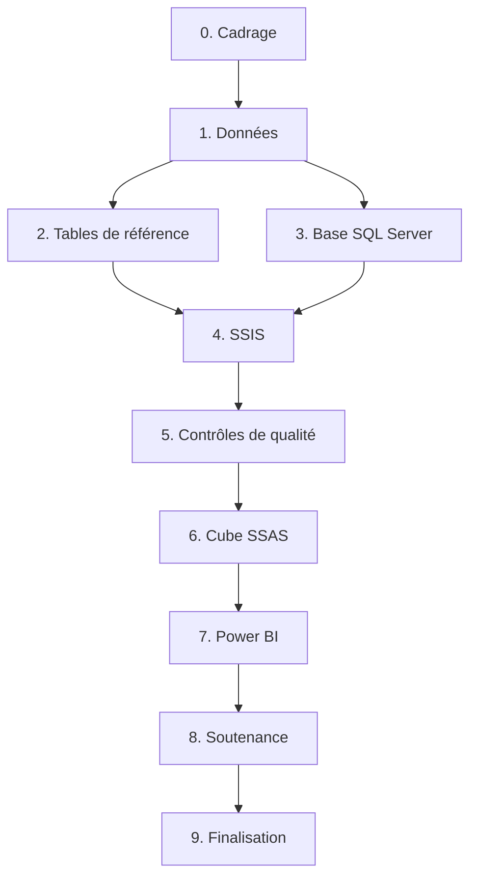

# Feuille de route détaillée

Plan de réalisation du projet BI sur le trafic aérien commercial français, de la validation du sujet à la soutenance. Il suit la chaîne imposée par le cours (SSIS, SQL Server, cube SSAS, Power BI) et la grille de notation `notation_projet.pdf`. Le contexte, le modèle et les choix de données sont décrits dans le [README](../README.md).

Chaque tâche a une case à cocher, un résultat attendu et, quand c'est utile, un critère de validation. Les colonnes « Responsable » sont à remplir par le groupe.

## Sommaire

- [Vue d'ensemble](#vue-densemble)
- [Correspondance avec la grille de notation](#correspondance-avec-la-grille-de-notation)
- [Phase 0 — Cadrage et organisation](#phase-0--cadrage-et-organisation)
- [Phase 1 — Acquisition et compréhension des données](#phase-1--acquisition-et-compréhension-des-données)
- [Phase 2 — Tables de référence (enrichissement)](#phase-2--tables-de-référence-enrichissement)
- [Phase 3 — Base SQL Server](#phase-3--base-sql-server)
- [Phase 4 — Alimentation avec SSIS](#phase-4--alimentation-avec-ssis)
- [Phase 5 — Contrôles de qualité](#phase-5--contrôles-de-qualité)
- [Phase 6 — Cube OLAP avec SSAS](#phase-6--cube-olap-avec-ssas)
- [Phase 7 — Tableaux de bord Power BI](#phase-7--tableaux-de-bord-power-bi)
- [Phase 8 — Support de soutenance](#phase-8--support-de-soutenance)
- [Phase 9 — Finalisation](#phase-9--finalisation)
- [Risques et parades](#risques-et-parades)
- [Valeurs de référence pour les contrôles](#valeurs-de-référence-pour-les-contrôles)

## Vue d'ensemble

| Phase | Contenu | Dépend de | Responsable |
|---|---|---|---|
| 0 | Validation du sujet, répartition, installation des outils | | |
| 1 | Téléchargement, dictionnaire des variables, profilage | 0 | |
| 2 | Régions, continents, compagnies, lignes TGV, périodes | 1 | |
| 3 | Base, schémas, tables brutes, dimensions, faits | 1 | |
| 4 | Packages SSIS de chargement et d'alimentation, déploiement | 2, 3 | |
| 5 | Requêtes de contrôle et recoupements | 4 | |
| 6 | Projet SSAS, cube, mesures calculées, déploiement | 5 | |
| 7 | Rapport Power BI connecté au cube, publication | 6 | |
| 8 | Support de soutenance | 7 | |
| 9 | README, retour d'expérience, livraison | 8 | |

Les phases 2 et 3 peuvent avancer en parallèle. Dès que la phase 4 charge une première série (APT), on peut commencer un cube et un rapport minimaux pour valider toute la chaîne, puis élargir : c'est l'approche « horizontale » recommandée par le cours.

## Correspondance avec la grille de notation

| Critère de la grille | Points | Tâches |
|---|---|---|
| Présentation générale (contexte, problématique, objectifs, solution, membres, répartition du travail) | 1 | 8.2 |
| Présentation du jeu de données | 1 | 1.2, 1.3, 8.2 |
| Méthode : matrice de bus, grille de priorisation, intégration SSIS, étoile et cube | 2 | 0.4, 0.5, 8.2 |
| Présentation des visuels Power BI | 1 | 7, 8.2 |
| Créer une nouvelle base SQL Server | 1 | 3.1 |
| Créer un ETL SSIS et alimenter la base avec les données brutes | 2 | 4.1 à 4.3 |
| Déployer le package SSIS dans SSMS | 1 | 4.6 |
| Créer les tables de dimensions dans SSMS | 1 | 3.3 |
| Cohérence du modèle en étoile avec la matrice de bus | 1 | 3.5 |
| Création du projet SSAS | 1 | 6.1 |
| Création et déploiement du cube OLAP | 2 | 6.2 à 6.6 |
| Vérification du schéma du cube avec le modèle en étoile | 1 | 6.7 |
| Connexion à une base SSAS (OLAP) | 1 | 7.1 |
| Visuels pertinents pour chaque cas d'usage (au moins 4) | 3 | 7.3 à 7.7 |
| Déploiement de Power BI sur le serveur de l'école | 1 | 7.9 |

---

## Phase 0 — Cadrage et organisation

### 0.1 Faire valider la thématique

- [ ] Envoyer à l'enseignant un résumé d'une demi-page : problématique, cinq cas d'usage, séries DGAC retenues, lien vers le README.
- [ ] Lui demander de confirmer trois points :
  - [ ] le barème qui s'applique (5/6/4/5 dans les consignes, 5/5/5/5 dans la grille de notation) ;
  - [ ] le type de projet SSAS attendu (multidimensionnel, puisque la grille parle de cube OLAP, ou tabulaire) ;
  - [ ] le serveur de l'école pour la publication Power BI : adresse, type (Power BI Report Server ou autre), version de Power BI Desktop à utiliser, droits d'accès.
- [ ] Noter la réponse et la date dans `docs/`.

Critère de validation : sujet accepté par écrit.

### 0.2 Répartir le travail

La soutenance doit présenter la répartition du travail : la décider tôt et la tenir à jour.

| Domaine | Tâches | Responsable |
|---|---|---|
| Données et enrichissement | Phases 1, 2, 5 | |
| Base et ETL | Phases 3, 4 | |
| Cube et rapport | Phases 6, 7 | |
| Soutenance | Phase 8 (tous) | |

- [ ] Remplir le tableau ci-dessus.
- [ ] Prévoir un point d'avancement par semaine (15 minutes suffisent).

### 0.3 Installer les outils

Sur chaque poste qui développe :

- [ ] **SQL Server** (édition Developer, gratuite) avec les services Database Engine, Integration Services et Analysis Services en **mode multidimensionnel**. Le mode d'Analysis Services se choisit à l'installation : vérifier avant de valider.
- [ ] **SQL Server Management Studio (SSMS)**.
- [ ] **Visual Studio** (Community suffit) avec les extensions **SQL Server Integration Services Projects** et **Microsoft Analysis Services Projects**.
- [ ] **Power BI Desktop**, dans la version compatible avec le serveur de l'école si c'est un Power BI Report Server (version « optimisée pour Report Server »).
- [ ] **Python** avec pandas, pour l'exploration seulement.
- [ ] Activer le hook du dépôt : `git config core.hooksPath .githooks`.

Critère de validation : chaque membre ouvre SSMS, se connecte au moteur et à Analysis Services, et crée un projet SSIS vide dans Visual Studio.

### 0.4 Finaliser la matrice de bus décisionnel

- [ ] Relire la matrice du README (processus en lignes, dimensions en colonnes).
- [ ] Vérifier qu'aucun processus n'utilise une dimension que sa série ne fournit pas.
- [ ] Préparer sa version de soutenance (tableau propre, une diapositive).

### 0.5 Valider la grille de priorisation

- [ ] Discuter en groupe la valeur métier et la facilité de chaque thème.
- [ ] Confirmer les lots : lot 1 (gagnants et perdants, reprise, destinations et TGV), lot 2 (saisonnalité, low-cost).
- [ ] Reporter la grille définitive dans le README.

### 0.6 Conventions de travail

- [ ] Branche `main` uniquement pour l'instant ; commits en français, au format `type: description`.
- [ ] Aucun emoji, aucune ligne `Co-Authored-By`.
- [ ] Ne jamais versionner de mot de passe ni de chaîne de connexion contenant des identifiants.
- [ ] Décider si les CSV bruts sont versionnés (environ 4 Mo compressés au total : c'est acceptable) ou seulement documentés.

---

## Phase 1 — Acquisition et compréhension des données

### 1.1 Télécharger les séries

- [ ] Télécharger depuis la [page data.gouv.fr](https://www.data.gouv.fr/datasets/trafic-aerien-commercial-mensuel-francais-par-paire-daeroports-par-sens-depuis-1990) :
  - [ ] `ASP_APT_1990_2025.zip`
  - [ ] `ASP_LSN_1990_2025.zip`
  - [ ] `ASP_CIE_2010_2025.zip`
  - [ ] les notices `Notice_ASP_serie_APT.pdf`, `Notice_ASP_serie_LSN.pdf`, `Notice_ASP_serie_CIE.pdf`
- [ ] Décompresser dans `data/raw/apt/`, `data/raw/lsn/`, `data/raw/cie/` (un CSV par année).
- [ ] Copier les notices dans `docs/notices/`.
- [ ] Noter dans `data/raw/SOURCE.md` la date de téléchargement et les adresses exactes des fichiers.

Critère de validation : 36 fichiers APT, 36 LSN, 16 CIE.

### 1.2 Rédiger le dictionnaire des variables

- [ ] Créer `docs/dictionnaire-des-donnees.md` avec, pour chaque colonne de chaque série : nom, signification (d'après la notice), type, unité, exemple.
- [ ] Colonnes à documenter :
  - [ ] APT : `ANMOIS`, `APT`, `APT_NOM`, `APT_ZON`, `APT_PEQ`, `APT_PAX_dep`, `APT_PAX_arr`, `APT_PAX_tr`, `APT_FRP_dep`, `APT_FRP_arr`, `APT_NMVT_mxt`, `APT_NMVT_cgo`
  - [ ] LSN : `ANMOIS`, `LSN_SEG`, `LSN_FSC`, `LSN_1`, `LSN_2`, `LSN_2_CONT`, `LSN_PEQ`, `LSN_PEQKT`, `LSN_PAX`, `LSN_PKT`, `LSN_FRP`, `LSN_TKT`, `LSN_DRT`
  - [ ] CIE : `ANMOIS`, `CIE`, `CIE_NOM`, `CIE_NAT`, `CIE_PAYS`, `CIE_PAX`, `CIE_FRP`, `CIE_PEQ`, `CIE_PKT`, `CIE_TKT`, `CIE_PEQKT`, `CIE_VOL`
- [ ] Vérifier dans les notices les unités qui ne sont pas évidentes : `CIE_PKT` (en milliards ?), `LSN_DRT`, `APT_PEQ`.
- [ ] Ajouter les définitions DGAC utiles à la soutenance : unité de trafic (UDT), passager équivalent (PEQ), passagers-kilomètres.

### 1.3 Profiler les données

Dans `notebooks/01_profilage.ipynb` :

- [ ] Charger toutes les années de chaque série (séparateur `;`, décimales à la virgule, encodage UTF-8 avec BOM).
- [ ] Pour chaque série et chaque année : nombre de lignes, nombre de mois présents, cellules vides, valeurs négatives.
- [ ] Lister les valeurs distinctes des colonnes de catégorie : `APT_ZON`, `LSN_SEG`, `LSN_FSC`, `LSN_2_CONT`, `CIE_NAT`.
- [ ] Lister les pseudo-membres : `ZZMT`, `ZZOM`, « AUTRES CIE (E) » et « AUTRES CIE (F) » (codes `ZZE`, `ZZF`), pays `*_AUTRE`.
- [ ] Repérer les ruptures de série :
  - [ ] codes OACI présents certaines années seulement (147 codes vus, 67 présents les 36 ans) ;
  - [ ] noms d'aéroports qui changent pour un même code ;
  - [ ] compagnies qui changent de code ou de nom (par exemple les entités easyJet) ;
  - [ ] pays qui changent de libellé.
- [ ] Vérifier l'identité `PEQ = PAX + 10 × FRP` (fret en tonnes) et lister les écarts.
- [ ] Vérifier que le total LSN égale le total CIE chaque année depuis 2010.
- [ ] Exporter un résumé du profilage dans `docs/profilage.md` : il alimentera la partie nettoyage de la soutenance.

Critère de validation : chaque anomalie trouvée a une règle de traitement décidée (corriger, regrouper, signaler ou ignorer), notée dans `docs/regles-de-nettoyage.md`.

---

## Phase 2 — Tables de référence (enrichissement)

Les tables sont des CSV dans `data/ref/`, séparateur `;`, UTF-8, une ligne d'en-tête. Chacune indique sa source dans `data/ref/SOURCES.md`.

### 2.1 Aéroports : `ref_aeroport.csv`

Colonnes : `code_oaci;region;categorie`

- [ ] Partir de la liste des 147 codes OACI présents au moins une fois dans APT.
- [ ] Renseigner la **région** (13 régions de métropole, régions et collectivités d'outre-mer). Source : la commune de l'aéroport, puis le découpage régional actuel.
- [ ] Renseigner la **catégorie** :
  - [ ] `Hub parisien` : LFPG (Roissy-Charles-de-Gaulle), LFPO (Orly) ;
  - [ ] `Grand régional` : à définir par un seuil (par exemple plus de 5 M passagers en 2019) ;
  - [ ] `Régional` ;
  - [ ] `Touristique` : à justifier (forte saisonnalité estivale ou hivernale, à mesurer en phase 1) ;
  - [ ] `Outre-mer`.
- [ ] Ajouter une ligne pour chaque pseudo-membre : `ZZMT` (région « Autres métropole »), `ZZOM` (« Autres outre-mer »).
- [ ] Documenter la règle de catégorisation dans `SOURCES.md`.

Critère de validation : chaque code OACI de APT a exactement une ligne.

### 2.2 Pays : `ref_pays.csv`

Colonnes : `pays;continent`

- [ ] Partir des valeurs distinctes de `LSN_2` (101 pays et zones en 2025) et de `CIE_PAYS`.
- [ ] Harmoniser les libellés entre les deux séries (accents, majuscules, noms différents pour un même pays) : la dimension pays est partagée.
- [ ] Reprendre le continent de `LSN_2_CONT` quand il existe ; compléter à la main pour les pays présents seulement dans CIE.
- [ ] Ajouter `FRANCE` (continent `Europe`), utilisée comme destination des faisceaux intérieurs.
- [ ] Garder les zones regroupées (`AFRIQUE_AUTRE`, etc.) comme pseudo-membres.

### 2.3 Compagnies : `ref_compagnie.csv`

Colonnes : `code_cie;groupe;modele`

- [ ] Partir des codes distincts de CIE (environ 140 par an, davantage sur 16 ans).
- [ ] Renseigner le **groupe** commercial : easyJet (UK, Europe, Switzerland), Air France-KLM (Air France, KLM, Transavia France, Transavia Pays-Bas, HOP!, Regional, Brit Air), Lufthansa, IAG, etc.
- [ ] Renseigner le **modèle** : `Low-cost`, `Traditionnelle`, `Régionale`, `Charter`, `Cargo`.
- [ ] Traiter d'abord les compagnies qui dépassent 1 M passagers par an (une trentaine, environ 65 % du trafic) ; classer les autres ensuite, ou en `Non classée` si le temps manque.
- [ ] Documenter les choix discutables (Transavia : low-cost filiale d'un groupe traditionnel).

### 2.4 Lignes TGV : `ref_lignes_tgv.csv`

Colonnes : `ligne;date_mise_en_service;liaisons_concernees`

- [ ] Recenser les mises en service des lignes à grande vitesse depuis 1990 (Atlantique, Nord, Rhône-Alpes, Méditerranée, Est, Rhin-Rhône, Bretagne-Pays de la Loire, Sud Europe Atlantique, etc.) à partir d'une source publique citée.
- [ ] Indiquer les liaisons aériennes Paris-province concurrencées.

Cette table sert à annoter les graphiques ; elle n'est pas forcément une dimension du cube.

### 2.5 Périodes : règle de calcul

- [ ] Définir les périodes de `d_temps` : `Avant-crise` (jusqu'à février 2020), `Crise sanitaire` (mars 2020 à décembre 2021, à valider), `Reprise` (à partir de 2022).
- [ ] Justifier les bornes dans `docs/regles-de-nettoyage.md`.

---

## Phase 3 — Base SQL Server

Scripts dans `sql/`, numérotés dans l'ordre d'exécution. Chaque script peut être relancé sans erreur (`IF OBJECT_ID(...) IS NOT NULL DROP ...` ou `CREATE OR ALTER`).

### 3.1 Créer la base

- [ ] `sql/01_creation_base.sql` : créer la base `TraficAerien`.
- [ ] Créer deux schémas : `stg` (tables brutes) et `dw` (entrepôt en étoile).
- [ ] Fixer le classement (collation) en français insensible à la casse, par exemple `French_CI_AS`.

Critère de validation : la base apparaît dans SSMS avec ses deux schémas. Capture d'écran pour la soutenance.

### 3.2 Créer les tables brutes

`sql/02_tables_brutes.sql` : une table par série et par table de référence, avec les colonnes du CSV en texte (`NVARCHAR`), sans contrainte. Les conversions se font plus tard, dans SSIS.

- [ ] `stg.apt` (12 colonnes APT) + `fichier_source`, `date_chargement`
- [ ] `stg.lsn` (13 colonnes LSN) + `fichier_source`, `date_chargement`
- [ ] `stg.cie` (12 colonnes CIE) + `fichier_source`, `date_chargement`
- [ ] `stg.ref_aeroport`, `stg.ref_pays`, `stg.ref_compagnie`

### 3.3 Créer les tables de dimensions

`sql/03_dimensions.sql` :

- [ ] `dw.d_temps` : `id_temps INT` (clé `AAAAMM`, PK), `annee`, `trimestre`, `mois`, `nom_mois` (« Juillet »), `annee_mois` (« 2010-07 »), `periode`.
- [ ] `dw.d_aeroport` : `id_aeroport INT IDENTITY` (PK), `code_oaci` (unique), `nom`, `zone`, `region`, `categorie`.
- [ ] `dw.d_faisceau` : `id_faisceau INT IDENTITY` (PK), `code` (unique), `libelle`, `segment`.
- [ ] `dw.d_pays` : `id_pays INT IDENTITY` (PK), `nom` (unique), `continent`.
- [ ] `dw.d_compagnie` : `id_compagnie INT IDENTITY` (PK), `code` (unique), `nom`, `groupe`, `modele`.
- [ ] Dans chaque dimension, un membre « Inconnu » de clé `-1`, pour qu'aucun fait ne soit rejeté si une référence manque.

Critère de validation : les cinq tables sont visibles dans SSMS. Capture d'écran pour la soutenance (critère noté).

### 3.4 Créer les tables de faits

`sql/04_faits.sql` :

- [ ] `dw.f_trafic_aeroport` : `id_temps`, `id_aeroport`, `pax_depart`, `pax_arrivee`, `pax_transit`, `fret_depart_t`, `fret_arrivee_t`, `mvt_mixtes`, `mvt_cargo`. Clé primaire composée (`id_temps`, `id_aeroport`).
- [ ] `dw.f_trafic_liaison` : `id_temps`, `id_faisceau`, `id_pays_destination`, `pax`, `fret_t`, `pax_km`, `tonnes_km`. Clé primaire (`id_temps`, `id_faisceau`, `id_pays_destination`).
- [ ] `dw.f_trafic_compagnie` : `id_temps`, `id_compagnie`, `id_pays_rattachement`, `pax`, `fret_t`, `vols`, `pax_km`. Clé primaire (`id_temps`, `id_compagnie`).
- [ ] Clés étrangères vers chaque dimension.
- [ ] Types : `INT` pour les comptages, `DECIMAL(12,1)` pour le fret, `BIGINT` pour les passagers-kilomètres.

### 3.5 Vérifier la cohérence avec la matrice de bus

- [ ] Générer le diagramme de base de données dans SSMS (« Database Diagrams »).
- [ ] Vérifier ligne à ligne que chaque table de faits n'est reliée qu'aux dimensions cochées dans la matrice.
- [ ] Conserver la capture du diagramme pour la soutenance (critère noté : cohérence étoile / matrice).

### 3.6 Créer les vues de contrôle

`sql/05_vues_controle.sql` :

- [ ] `dw.v_total_annuel_apt`, `dw.v_total_annuel_lsn`, `dw.v_total_annuel_cie` : passagers par année.
- [ ] `dw.v_ecart_lsn_cie` : différence de passagers entre LSN et CIE par année (attendue à zéro ou presque depuis 2010).

---

## Phase 4 — Alimentation avec SSIS

Un projet Visual Studio `ssis/TraficAerien.ETL`. Chaque package fait une chose ; un package maître les enchaîne.

### 4.1 Préparer le projet

- [ ] Créer le projet Integration Services.
- [ ] Créer les **gestionnaires de connexions** au niveau du projet : `OLEDB_TraficAerien` (base), et un gestionnaire de fichiers plats par série.
- [ ] Créer les **paramètres de projet** : `DossierDonnees` (chemin de `data/raw`), `DossierRef` (chemin de `data/ref`), `ServeurSQL`. Aucun chemin en dur dans les packages.

### 4.2 Charger les données brutes

Un package par série, sur le même modèle :

- [ ] `10_stg_apt.dtsx`
  - [ ] Tâche SQL : `TRUNCATE TABLE stg.apt`.
  - [ ] Conteneur de boucle **Foreach** sur `DossierDonnees\apt\*.csv`, la variable `FichierCourant` alimentant la chaîne de connexion du fichier plat.
  - [ ] Flux de données : source fichier plat (séparateur `;`, page de code 65001 UTF-8, en-tête en première ligne) → colonne dérivée `fichier_source` et `date_chargement` → destination OLE DB `stg.apt`.
- [ ] `11_stg_lsn.dtsx` : même modèle.
- [ ] `12_stg_cie.dtsx` : même modèle.
- [ ] `13_stg_ref.dtsx` : les trois tables de référence.

Point d'attention : le BOM UTF-8 peut coller au nom de la première colonne (`ANMOIS`). Vérifier le nom lu par la source et le renommer si besoin.

Critère de validation : nombre de lignes de chaque table `stg` égal au total des lignes des CSV (sans les en-têtes).

### 4.3 Nettoyer et convertir

Ces transformations se font dans les packages de dimensions et de faits, ou dans des vues `stg.v_*_propre` lues par ces packages. Chaque règle est notée dans `docs/regles-de-nettoyage.md`, avec le nombre de lignes concernées : c'est le contenu de la partie nettoyage de la soutenance.

- [ ] Convertir les décimales : remplacer la virgule par un point, puis convertir en `DECIMAL`.
- [ ] Convertir les comptages en `INT` ; valeur vide → 0, avec comptage des cas.
- [ ] Supprimer les espaces en début et fin des libellés (les pseudo-membres commencent par un espace : `" AUTRES APT (MT)"`).
- [ ] Uniformiser la casse et les accents des libellés de pays entre LSN et CIE.
- [ ] Extraire année et mois de `ANMOIS` (`AAAAMM`).
- [ ] Rejeter dans une table `stg.rejets` toute ligne qui ne se convertit pas, avec le motif.

### 4.4 Alimenter les dimensions

- [ ] `20_dim_temps.dtsx` : générer les 432 mois de janvier 1990 à décembre 2025 (boucle SQL ou CTE récursive), avec les noms de mois en français et la période.
- [ ] `21_dim_aeroport.dtsx` : codes distincts de `stg.apt` ; nom = **dernier nom connu** (dimension à évolution lente de type 1) ; jointure avec `stg.ref_aeroport` pour la région et la catégorie ; zone depuis `APT_ZON`. Composant **Dimension à variation lente** de SSIS ou instruction `MERGE`.
- [ ] `22_dim_faisceau.dtsx` : les six faisceaux (`MET_INTL`, `OM_INTL`, `MET_RAD`, `MET_TRA`, `MET_OM`, `OM_OM`) avec un libellé lisible (« Paris-province », « Province-province »…) et le segment (`NAT` → Intérieur, `INTL` → International).
- [ ] `23_dim_pays.dtsx` : union des pays de LSN et de CIE, harmonisés, plus `FRANCE` ; continent depuis `stg.ref_pays`.
- [ ] `24_dim_compagnie.dtsx` : codes distincts de `stg.cie` ; dernier nom connu ; groupe et modèle depuis `stg.ref_compagnie`, `Non classée` à défaut.

Critère de validation : aucun doublon de clé naturelle ; chaque dimension contient son membre « Inconnu » et ses pseudo-membres.

### 4.5 Alimenter les faits

Pour chaque table de faits : `TRUNCATE`, puis flux de données avec des **recherches (Lookup)** sur les dimensions pour remplacer les codes par les clés de substitution. Ligne sans correspondance → clé `-1` et comptage.

- [ ] `30_fait_aeroport.dtsx` : depuis `stg.apt`, recherches sur `d_temps` et `d_aeroport`.
- [ ] `31_fait_liaison.dtsx` : depuis `stg.lsn`, recherches sur `d_temps`, `d_faisceau`, `d_pays` (destination = `LSN_2` pour l'international, `FRANCE` pour l'intérieur).
- [ ] `32_fait_compagnie.dtsx` : depuis `stg.cie`, recherches sur `d_temps`, `d_compagnie`, `d_pays` (rattachement = `CIE_PAYS`).
- [ ] Agréger si une même clé apparaît deux fois (par exemple deux libellés de pays fusionnés vers le même membre).

### 4.6 Orchestrer et déployer

- [ ] `00_maitre.dtsx` : tâches **Exécuter le package** dans l'ordre 10 → 13, 20 → 24, 30 → 32, puis 90 (contrôles).
- [ ] `90_controles.dtsx` : exécute les requêtes de la phase 5 et échoue si un écart dépasse le seuil.
- [ ] Journalisation : activer la journalisation SSIS (niveau « Basic »).
- [ ] Créer le **catalogue SSISDB** dans SSMS (Integration Services Catalogs), puis un dossier `TraficAerien`.
- [ ] **Déployer le projet** depuis Visual Studio vers SSISDB (assistant de déploiement).
- [ ] Configurer les paramètres de projet dans l'environnement SSISDB (chemins réels).
- [ ] Exécuter `00_maitre` depuis SSMS et consulter le rapport d'exécution.

Critère de validation : exécution réussie depuis SSMS. Capture du rapport « All Executions » pour la soutenance (critère noté : déploiement du package dans SSMS).

---

## Phase 5 — Contrôles de qualité

Requêtes dans `sql/10_controles.sql`, du général au particulier, comme le recommande le cours. Les résultats sont notés dans `docs/controles.md`.

### 5.1 Contrôles de volume

- [ ] Nombre de lignes : CSV = `stg` = faits (moins les rejets justifiés).
- [ ] Nombre de mois par année dans chaque table de faits : 12.
- [ ] Nombre d'aéroports, de pays et de compagnies par année : comparer avec le profilage.

### 5.2 Contrôles de totaux

- [ ] Total annuel des passagers par série, comparé aux valeurs de référence (voir la dernière section).
- [ ] Total LSN = total CIE chaque année depuis 2010.
- [ ] Total mensuel pour quelques mois témoins : janvier 1990, août 2019, avril 2020, août 2025.
- [ ] Total d'un aéroport témoin (Bordeaux-Mérignac, `LFBD`) sur une année, comparé au CSV.

### 5.3 Contrôles d'intégrité

- [ ] Aucun fait avec une clé `-1` non justifiée.
- [ ] Aucune valeur négative.
- [ ] `PEQ` recalculé (passagers + 10 × fret) proche de la valeur DGAC.

### 5.4 Recoupement externe

- [ ] Comparer les totaux annuels avec les [bulletins statistiques de la DGAC](https://www.ecologie.gouv.fr/politiques-publiques/statistiques-du-trafic-aerien) pour 2019 et 2025.
- [ ] Expliquer tout écart (périmètre, double comptage APT).

Critère de validation : tous les contrôles passent ou ont une explication écrite.

---

## Phase 6 — Cube OLAP avec SSAS

Un projet Visual Studio `ssas/TraficAerien.Cube`, de type **Analysis Services multidimensionnel** (à confirmer en 0.1).

### 6.1 Créer le projet

- [ ] Nouveau projet « Analysis Services Multidimensional and Data Mining Project ».
- [ ] **Source de données** : connexion à la base `TraficAerien` ; mode d'emprunt d'identité adapté au serveur (compte de service ou identifiants dédiés).
- [ ] **Vue de source de données (DSV)** : ajouter les cinq dimensions et les trois faits du schéma `dw` ; vérifier que les relations sont détectées, sinon les créer (clés étrangères → clés primaires).

Critère de validation : le diagramme de la DSV reproduit le modèle en étoile. Capture pour la soutenance.

### 6.2 Créer les dimensions

Pour chaque dimension : assistant de dimension, puis réglage des attributs.

- [ ] **Temps** : attributs Année, Trimestre, Mois ; hiérarchie `Année → Trimestre → Mois` ; type de dimension « Time » ; tri des mois par numéro, pas par nom ; attribut Période.
- [ ] **Aéroport** : hiérarchie `Zone → Région → Aéroport` ; attribut Catégorie.
- [ ] **Faisceau** : hiérarchie `Segment → Faisceau`.
- [ ] **Pays** : hiérarchie `Continent → Pays`.
- [ ] **Compagnie** : hiérarchie `Modèle → Groupe → Compagnie`.
- [ ] Définir les **relations d'attributs** de chaque hiérarchie (par exemple Mois → Trimestre → Année) pour éviter les avertissements et accélérer les agrégations.
- [ ] Clé et nom distincts pour chaque attribut (clé = identifiant, nom = libellé).

### 6.3 Créer le cube et les groupes de mesures

- [ ] Assistant de cube : un cube `Trafic` avec trois **groupes de mesures** : `Trafic aéroport`, `Trafic liaison`, `Trafic compagnie`.
- [ ] Mesures : sommes de chaque colonne de fait, avec un format d'affichage (séparateur de milliers, une décimale pour le fret).
- [ ] Une mesure de comptage de lignes par groupe (utile pour les contrôles).

### 6.4 Régler l'utilisation des dimensions

Onglet « Dimension Usage » : il doit reproduire exactement la matrice de bus.

- [ ] Temps : relié aux trois groupes.
- [ ] Aéroport : relié à `Trafic aéroport` seulement.
- [ ] Faisceau : relié à `Trafic liaison` seulement.
- [ ] Pays : ajouté **deux fois** au cube (dimension de rôle) : `Pays de destination` relié à `Trafic liaison`, `Pays de rattachement` relié à `Trafic compagnie`.
- [ ] Compagnie : relié à `Trafic compagnie` seulement.
- [ ] Laisser vides les autres cases : une case vide signifie « sans rapport », et SSAS répète alors le total (propriété `IgnoreUnrelatedDimensions`, à documenter).

### 6.5 Créer les mesures calculées (MDX)

Power BI connecté en direct à un cube multidimensionnel ne permet pas de créer ses propres mesures : les ratios doivent être définis dans le cube.

- [ ] `Passagers aéroport` = départs + arrivées + transit.
- [ ] `Part du trafic national` = passagers de l'aéroport / passagers de tous les aéroports, à période égale.
- [ ] `Passagers même mois 2019` (avec `ParallelPeriod` ou une référence explicite à l'année 2019).
- [ ] `Écart à 2019 (%)` = (passagers − passagers même mois 2019) / passagers même mois 2019.
- [ ] `Croissance annuelle (%)` = évolution par rapport à l'année précédente.
- [ ] `Indice saisonnier` = passagers du mois / moyenne mensuelle de l'année.
- [ ] `Part de marché compagnie` = passagers de la compagnie / passagers de toutes les compagnies.
- [ ] `Part du domestique` = passagers des faisceaux intérieurs / passagers totaux (LSN).
- [ ] Tester chaque mesure dans le navigateur du cube sur un cas connu.

### 6.6 Déployer et traiter

- [ ] Propriétés du projet : serveur cible (instance Analysis Services), nom de la base `TraficAerien_OLAP`.
- [ ] **Déployer** puis **traiter** (Process Full).
- [ ] Vérifier dans SSMS (connexion Analysis Services) que la base et le cube existent.

Critère de validation : le cube se parcourt dans SSMS ou dans le navigateur de Visual Studio. Capture pour la soutenance (critère noté : création et déploiement du cube).

### 6.7 Vérifier le cube contre l'étoile

- [ ] Comparer, pour quelques années, les totaux du cube avec les vues de contrôle SQL (`dw.v_total_annuel_*`).
- [ ] Vérifier que chaque dimension du cube correspond à une table `d_*` et chaque groupe de mesures à une table `f_*`.
- [ ] Vérifier que l'onglet « Dimension Usage » est identique à la matrice de bus.
- [ ] Préparer une diapositive « matrice de bus → étoile → cube » (critère noté : vérification du schéma du cube).

---

## Phase 7 — Tableaux de bord Power BI

Un fichier `dashboard/TraficAerien.pbix`, une page par cas d'usage, plus une page d'accueil.

### 7.1 Se connecter au cube

- [ ] Power BI Desktop → Obtenir les données → **Base de données Analysis Services** → serveur et base `TraficAerien_OLAP` → mode **Connexion active** (live).
- [ ] Vérifier que les dimensions, hiérarchies et mesures calculées apparaissent.

Critère de validation : un visuel simple (passagers par année) s'affiche. Capture pour la soutenance (critère noté : connexion à une base SSAS).

### 7.2 Préparer la charte

- [ ] Thème Power BI (fichier JSON) : une couleur principale, une couleur d'accent pour les mises en évidence, gris pour le reste.
- [ ] Mêmes tailles de titres et d'étiquettes sur toutes les pages.
- [ ] Segments communs synchronisés entre pages : Année, Période.
- [ ] Une note de source sur chaque page : « Source : DGAC, data.gouv.fr ».

### 7.3 Page d'accueil

- [ ] Cartes : passagers 2025, écart à 2019, nombre d'aéroports, part du low-cost.
- [ ] Courbe : passagers mensuels 1990-2025, avec les creux de 2001, 2009 et 2020 annotés.
- [ ] Liens de navigation vers les cinq pages.

### 7.4 Cas d'usage 1 — Gagnants et perdants (lot 1)

Question : quels aéroports gagnent ou perdent du trafic ?

- [ ] Barres horizontales : croissance annuelle moyenne par aéroport sur la période choisie, triée, gagnants et perdants de couleurs différentes.
- [ ] Courbes : trajectoire des 10 premiers aéroports depuis 1990.
- [ ] Courbe aires empilées ou barres : part de Paris contre les régions dans le trafic national.
- [ ] Segments : période de comparaison (10 ou 30 ans), catégorie d'aéroport, zone.
- [ ] Info-bulle : passagers de début et de fin de période.

### 7.5 Cas d'usage 2 — Reprise après la crise sanitaire (lot 1)

Question : quels territoires ont retrouvé leur niveau de 2019, et quand ?

- [ ] Carte des régions (carte remplie ou carte à bulles) colorée selon l'écart à 2019.
- [ ] Matrice : régions en lignes, mois de 2020 à 2025 en colonnes, écart à 2019 en mise en forme conditionnelle.
- [ ] Courbe : indice base 100 en 2019 par catégorie d'aéroport.
- [ ] Tableau : mois de retour au niveau de 2019 par aéroport.

### 7.6 Cas d'usage 3 — Saisonnalité (lot 2)

Question : quels aéroports dépendent le plus de la saison ?

- [ ] Courbes : indice saisonnier mensuel par catégorie d'aéroport (hubs parisiens, régionaux, touristiques, outre-mer).
- [ ] Carte de chaleur (matrice) : aéroports en lignes, mois en colonnes.
- [ ] Barres : ratio pic / creux par aéroport.

### 7.7 Cas d'usage 4 — Destinations et concurrence du TGV (lot 1)

Question : où partent les passagers, et le train a-t-il remplacé l'avion ?

- [ ] Courbe : passagers Paris-province de 1990 à 2025, avec les mises en service TGV en lignes de référence ou annotations.
- [ ] Aires empilées : répartition par faisceau dans le temps.
- [ ] Carte du monde ou barres : passagers par pays de destination, avec forage continent → pays.
- [ ] Courbe : part du domestique dans le trafic total.

### 7.8 Cas d'usage 5 — Low-cost contre compagnies traditionnelles (lot 2)

Question : quelles compagnies captent la croissance ?

- [ ] Aires empilées à 100 % : part de marché par modèle de compagnie, de 2010 à 2025.
- [ ] Barres : 10 premiers groupes par passagers, avec segment d'année.
- [ ] Courbes : Air France contre easyJet, Ryanair, Transavia, Volotea.
- [ ] Carte : part du low-cost par pays de rattachement des compagnies.

### 7.9 Publier sur le serveur de l'école

- [ ] Obtenir l'adresse du serveur et les droits (voir 0.1).
- [ ] Vérifier que le serveur accède au cube SSAS (même réseau ou source de données configurée côté serveur).
- [ ] Publier le rapport ; configurer la source de données et les identifiants sur le serveur.
- [ ] Tester l'affichage depuis un autre poste et un autre compte.

Critère de validation : le rapport s'ouvre depuis le serveur de l'école. Capture pour la soutenance (critère noté).

### 7.10 Relecture du rapport

- [ ] Chaque page répond à sa question en moins de 10 secondes de lecture.
- [ ] Titres de visuels formulés comme des conclusions (par exemple « Paris-province a perdu 46 % depuis 2000 »).
- [ ] Unités affichées partout (M de passagers, tonnes, %).
- [ ] Aucun visuel ne mélange APT avec LSN ou CIE (double comptage).
- [ ] Les limites des données sont rappelées où elles comptent (seuils de publication, CIE depuis 2010).

---

## Phase 8 — Support de soutenance

### 8.1 Préparer la soutenance

- [ ] Durée et format exacts à confirmer auprès de l'enseignant.
- [ ] Prévoir une démonstration en direct du rapport, avec des captures de secours si le réseau ou le serveur ne répond pas.

### 8.2 Plan des diapositives

| # | Diapositive | Contenu | Critère de la grille |
|---|---|---|---|
| 1 | Titre | Sujet, cours, membres | |
| 2 | Contexte et problématique | Trois décennies de transformations, la question posée | Présentation générale |
| 3 | Objectifs et solution | Cinq cas d'usage, chaîne SSIS → SQL Server → SSAS → Power BI | Présentation générale |
| 4 | Équipe et répartition du travail | Qui a fait quoi | Présentation générale |
| 5 | Le jeu de données | Les trois séries, grain, période, seuils, PAP écartée et pourquoi | Jeu de données |
| 6 | Méthode | Démarche agile « horizontale », étapes du projet | Méthode |
| 7 | Matrice de bus décisionnel | Processus × dimensions | Méthode |
| 8 | Grille de priorisation | Valeur métier × facilité, lots | Méthode |
| 9 | Architecture | Schéma CSV → `stg` → `dw` → cube → Power BI | Méthode |
| 10 | Intégration SSIS | Flux de contrôle du package maître, exemple de flux de données, déploiement SSISDB | Méthode |
| 11 | Nettoyage des données | Règles appliquées et nombre de lignes concernées | Nettoyage |
| 12 | Enrichissement | Tables de référence et leurs sources | Nettoyage |
| 13 | Modèle en étoile | Diagramme SSMS, clés de substitution, pseudo-membres, dimension à évolution lente | Méthode |
| 14 | Cube OLAP | Dimensions, hiérarchies, groupes de mesures, utilisation des dimensions | Méthode |
| 15 | Contrôles de qualité | Totaux comparés, recoupement DGAC | Méthode |
| 16 à 20 | Un cas d'usage par diapositive | Question, visuel clé, conclusion | Visuels Power BI |
| 21 | Démonstration | Rapport publié sur le serveur de l'école | Visuels Power BI |
| 22 | Retour d'expérience | Réalisations notables, difficultés, extensions possibles | |
| 23 | Questions | | |

### 8.3 Retour d'expérience

Tenir dès le début un journal dans `docs/journal.md` (date, problème, solution), pour rédiger ensuite :

- [ ] **Réalisations notables** : par exemple la constellation de trois étoiles et les dimensions conformes, les contrôles automatiques.
- [ ] **Difficultés** : par exemple les seuils de publication, le double comptage APT, l'harmonisation des pays, la classification des compagnies.
- [ ] **Extensions possibles** : intégrer la série PAP pour quelques liaisons, ajouter la ponctualité depuis une autre source, ajouter des données de population pour un trafic par habitant, actualisation annuelle automatique.

### 8.4 Répétition

- [ ] Une répétition complète chronométrée.
- [ ] Préparer les questions probables : pourquoi PAP est écartée ; pourquoi trois tables de faits ; comment est gérée une compagnie qui change de nom ; que signifie une case vide dans la matrice de bus ; pourquoi APT dépasse LSN.

---

## Phase 9 — Finalisation

- [ ] Mettre à jour le README : cocher la feuille de route, ajouter des captures du rapport dans `docs/captures/`.
- [ ] Vérifier que le dépôt permet de tout reconstruire : scripts SQL, projets SSIS et SSAS, `.pbix`, tables de référence, instructions de démarrage.
- [ ] Supprimer les fichiers temporaires et les chemins personnels des projets.
- [ ] Déposer les livrables : support de soutenance et `.pbix`.
- [ ] Dernier commit et push.

---

## Risques et parades

| Risque | Conséquence | Parade |
|---|---|---|
| Analysis Services installé en mode tabulaire | Impossible de créer un cube multidimensionnel | Choisir le mode multidimensionnel à l'installation ; sinon réinstaller l'instance |
| Serveur de l'école inaccessible ou de version différente | Publication impossible | Clarifier en 0.1 ; garder des captures de secours |
| Power BI ne peut pas créer de mesures en connexion active | Ratios manquants | Les définir en MDX dans le cube (6.5) |
| Classification manuelle des compagnies trop longue | Cas d'usage 5 retardé | Classer d'abord les 30 plus grandes (environ 65 % du trafic) ; le reste en « Non classée » |
| Libellés de pays différents entre LSN et CIE | Dimension pays en double | Table de correspondance dans `ref_pays.csv` |
| BOM UTF-8 ou virgules décimales mal lus par SSIS | Valeurs fausses ou rejetées | Page de code 65001, conversion explicite, contrôles de la phase 5 |
| Aéroport absent certaines années | Faux « déclin » | Signaler les seuils dans le rapport ; filtrer sur les aéroports présents toute la période pour les classements |
| Un membre du groupe indisponible | Retard | Chaque domaine documenté et compris par au moins deux personnes |

## Valeurs de référence pour les contrôles

Mesurées sur les fichiers publiés en 2026 (données 1990-2025). Passagers en millions, sommes sur les douze mois.

| Année | APT (départs + arrivées + transit) | LSN | CIE |
|---|---|---|---|
| 1990 | 88,1 | 62,5 | |
| 2000 | 135,6 | 101,7 | |
| 2010 | 153,6 | 124,9 | 124,9 |
| 2019 | 214,4 | 179,5 | 179,5 |
| 2020 | 70,1 | 54,2 | 54,2 |
| 2025 | 210,6 | 183,0 | 183,0 |

| Contrôle | Valeur attendue |
|---|---|
| Lignes APT en 2025 | 990 |
| Aéroports détaillés en 2025 (APT) | 97, pseudo-membres compris |
| Aéroports vus au moins une fois de 1990 à 2025 | 147 |
| Aéroports présents les 36 ans | 67 |
| Codes compagnies en 2025 (CIE) | 141, dont les 2 pseudo-membres `ZZE` et `ZZF` (« AUTRES CIE ») |
| Pays et zones de destination en 2025 (LSN) | 101, dont 5 zones « autres » |
| Faisceaux (LSN) | 6 |
| Paris-province en 2000 / 2025 (LSN, M passagers) | 21,2 / 11,4 |

La série CIE ne commence qu'en 2010 : pas de valeur pour 1990 et 2000.
